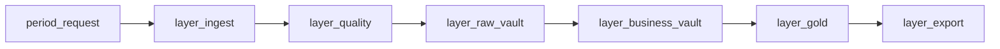
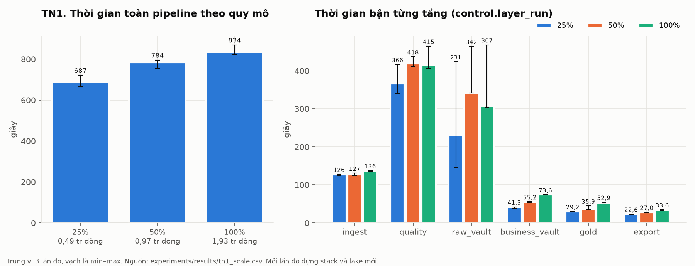
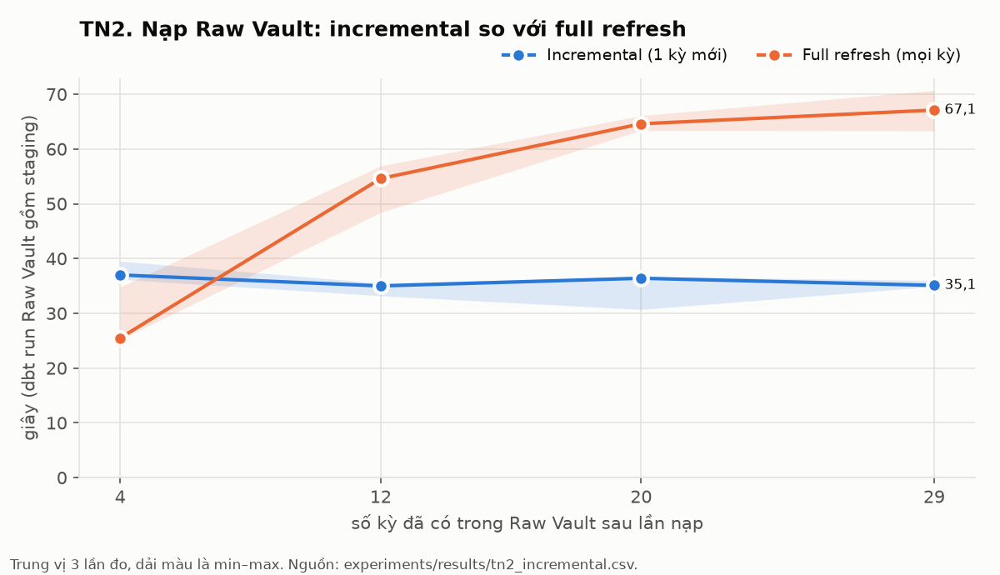
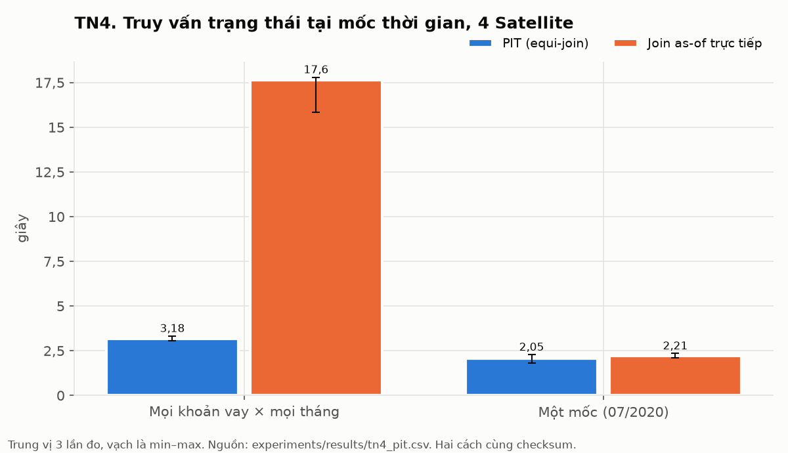
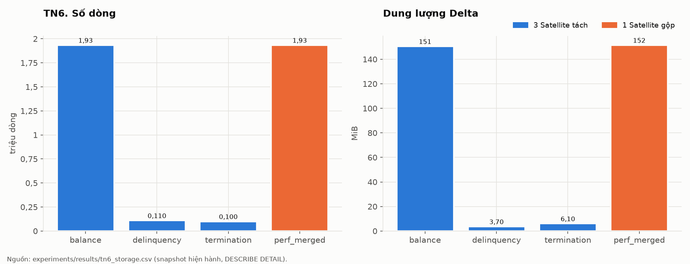
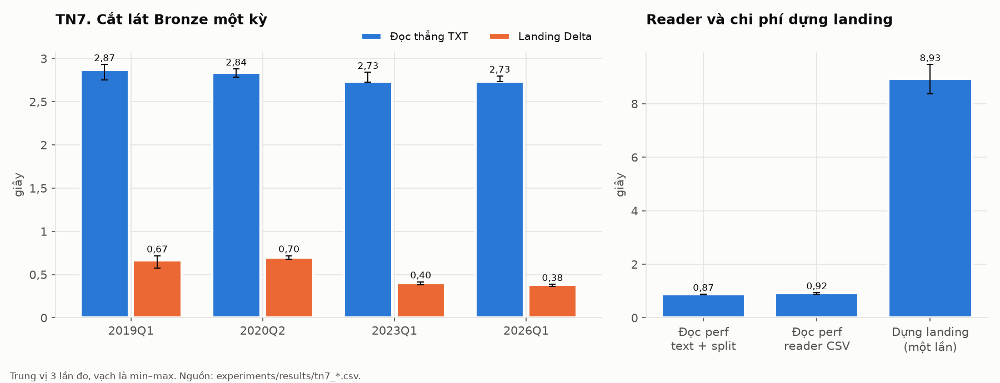
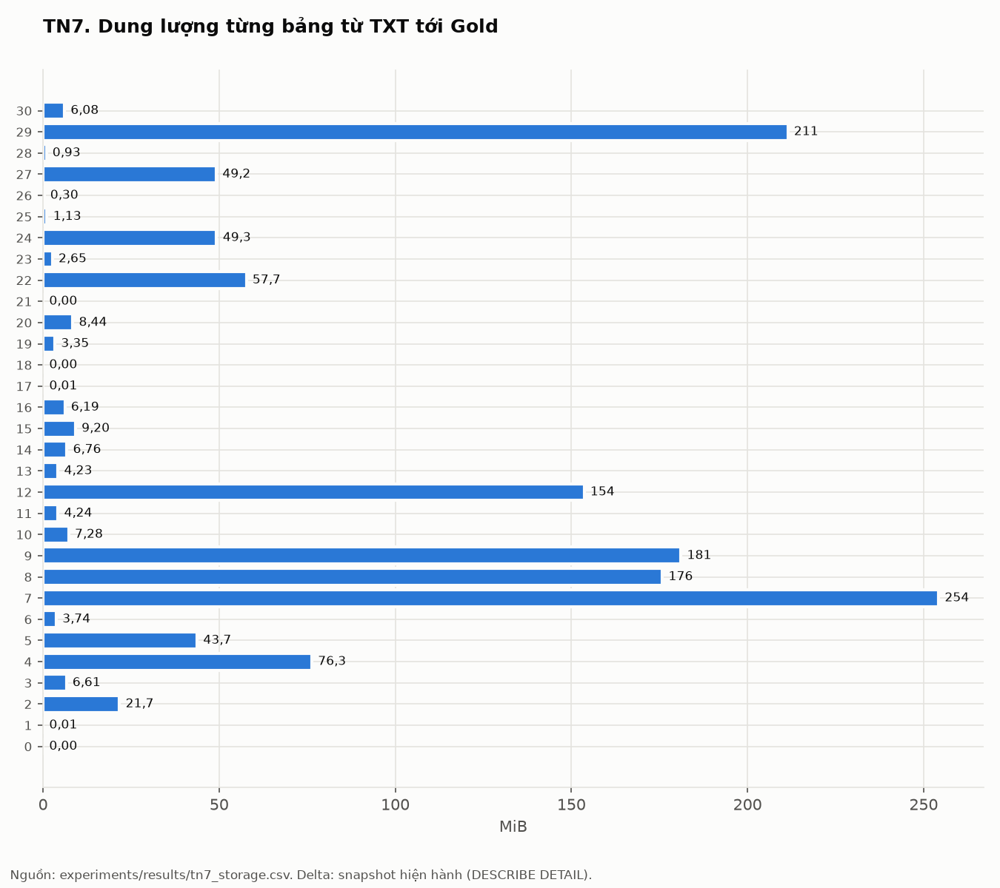

# Xây dựng Data Lakehouse kết hợp Data Vault 2.0 trên Apache Spark cho phân tích rủi ro tín dụng khoản vay thế chấp

**Báo cáo kỹ thuật — cập nhật 05/11/2026**

> Phạm vi số liệu: **Freddie Mac sample vintage 2019** (50.000 khoản vay, 1.934.614 quan sát khoản vay–tháng) và các tập con 25%, 50% của nó. Theo R-38 (PRD 1.9), bộ mẫu là phạm vi nghiệm thu cuối; bộ đầy đủ 2019 là hướng phát triển. Số liệu không đại diện cho toàn bộ vintage 2019 hay thị trường thế chấp, và không dùng để kết luận hiệu năng trên bộ đầy đủ.

## Tóm tắt

Đồ án xây dựng một pipeline chạy bằng một lệnh, đưa dữ liệu khoản vay Freddie Mac vintage 2019 từ file TXT qua landing Delta, Bronze, cổng chất lượng, Raw Vault, Business Vault và Gold tới PostgreSQL, phục vụ phân tích rủi ro tín dụng và truy vết lịch sử dữ liệu. PySpark nạp dữ liệu, kiểm tra kỹ thuật và xuất mart; dbt-spark cùng AutomateDV mô hình hóa Data Vault; Airflow điều phối mỗi tầng như một job độc lập đọc bảng điều khiển.

Báo cáo tập trung vào kỹ thuật xử lý dữ liệu ở từng tầng: đọc TXT dạng text rồi tự tách trường để giữ bằng chứng lỗi; landing Delta phân vùng theo tháng để mỗi kỳ chỉ đọc 3 tháng; ghi đè đúng lát kỳ bằng `replaceWhere`; cổng chất lượng tách hard rule, bản sao và xung đột khóa bằng hàm cửa sổ; băm khóa SHA-256 và nạp Satellite chỉ chèn khi `hash_diff` đổi; PIT với con trỏ và ghost record để mọi join là equi-join; công bố mart PostgreSQL trong một transaction.

Trên bộ mẫu, pipeline đạt 9 tiêu chí nghiệm thu AC-01–AC-09 và năm thực nghiệm C5; toàn bộ 89 kiểm tra C0–C5 đạt trên clone sạch của bản code freeze (C6), mỗi cấu hình ba lần đo, mỗi thực nghiệm có phép kiểm đúng đi kèm. Landing làm lát Bronze một kỳ nhanh hơn 4–8 lần so với đọc thẳng TXT; PIT nhanh hơn 5,6 lần so với join as-of trực tiếp khi lấy trạng thái mọi khoản vay ở mọi mốc; nạp Raw Vault tăng dần cho cùng số dòng với dựng lại toàn bộ và giữ thời gian một kỳ gần như không đổi (35,1 giây ở 29 kỳ, so với 67,1 giây khi dựng lại); tách Satellite theo tốc độ thay đổi giảm 94% số dòng của thuộc tính ít đổi nhưng không giảm tổng dung lượng trên Parquet. Ở quy mô sample, chi phí cố định của Spark và dbt chiếm phần lớn thời gian: dữ liệu tăng 3,9 lần, pipeline chỉ chậm thêm 11%.

**Từ khóa:** Data Lakehouse; Data Vault 2.0; Medallion; Apache Spark; Delta Lake; dbt; Freddie Mac; xử lý dữ liệu theo lô.

## 1. Bài toán và mục tiêu

### 1.1. Bối cảnh

Một danh mục khoản vay thế chấp cần được quan sát theo thời gian: khoản vay đang ở trạng thái nào, mức quá hạn thay đổi ra sao và dữ liệu mà hệ thống biết tại một thời điểm đến từ đợt nạp nào. Bài toán của đồ án đồng thời có nhu cầu phân tích danh mục và nhu cầu lưu lịch sử để đối soát. Năm câu hỏi phân tích và tiêu chí nghiệm thu được xác định trong [PRD, mục 3 và 6](PRD.md). Đây là phạm vi bài toán giả định của dự án, không phải mô tả quy trình nội bộ của Freddie Mac.

Freddie Mac công bố dữ liệu tín dụng ở cấp khoản vay và cung cấp các bộ dữ liệu qua cổng Clarity. Trang giới thiệu cũng lưu ý dữ liệu lịch sử có thể thay đổi và không được bảo đảm hoàn toàn đầy đủ, không có lỗi. Đặc điểm này tạo bối cảnh phù hợp để khảo sát cách tổ chức dữ liệu có lịch sử và kiểm soát chất lượng. [S1]

### 1.2. Câu hỏi cần giải quyết

| Mã | Câu hỏi phân tích | Đầu ra được cài đặt |
| --- | --- | --- |
| Q1 | Tỷ lệ quá hạn 30/60/90+ ngày biến động theo tháng thế nào, đặc biệt giai đoạn 2020–2021? | `mart_delinquency`, biểu đồ theo tháng |
| Q2 | Điểm tín dụng, LTV và DTI ban đầu liên hệ với quá hạn thế nào? | `mart_delinquency`, biểu đồ theo nhóm thuộc tính |
| Q3 | Bang và bên bán nào có danh mục rủi ro cao hơn theo chỉ số đã định nghĩa? | `mart_delinquency`, bảng và biểu đồ so sánh |
| Q4 | Nhóm có hoãn trả trong giai đoạn COVID có những kết cục nào sau lần hoãn trả cuối? | `mart_covid_forbearance` |
| Q5 | Tỷ lệ trả trước hạn thay đổi theo thời gian thế nào? | `mart_prepayment`, SMM và CPR |

Nguồn của ánh xạ trên là [PRD FR-15–FR-17](PRD.md) và [các model Gold](../dbt/models/gold/). Các quan hệ quan sát được trong Q2–Q3 là mô tả thống kê; thiết kế hiện tại không xác định tác động nhân quả.

### 1.3. Mục tiêu kỹ thuật

Pipeline cần nạp dữ liệu theo kỳ, giữ lịch sử sửa đổi, nhận biết các bản ghi lỗi, chạy lại an toàn và cung cấp dữ liệu cho notebook. Các mục tiêu được nghiệm thu bằng AC-01–AC-09 và cổng C0–C7 trong [Kế hoạch, mục 6](ke-hoach-trien-khai.md). Theo R-38 (PRD 1.9), phạm vi nghiệm thu cuối là bộ mẫu; trọng tâm báo cáo là các kỹ thuật xử lý dữ liệu ở từng tầng và số đo của chúng.

Đồ án triển khai trên một máy. Phạm vi không bao gồm streaming, cloud, mô hình dự báo, tích hợp nguồn FDIC hoặc dashboard Metabase. Giao diện phân tích là notebook; JupyterLab cung cấp môi trường mở và chạy notebook. Quyết định phạm vi nằm ở R-25, R-36 và R-38 trong [Review](review.md).

### 1.4. Lý do khảo sát Data Vault

Raw Vault tách khóa nghiệp vụ, quan hệ và lịch sử thuộc tính. Mô hình này được lựa chọn để khảo sát khả năng giữ các phiên bản nguồn và hỗ trợ truy vết trong bài toán đã xác định. Lập luận thực nghiệm chính là FR-14: cùng một đợt sửa được đưa vào Satellite và bảng đối chứng ghi đè SCD1, sau đó đối chiếu khả năng lấy giá trị trước và sau sửa.

Đối chứng SCD1 không đại diện cho mọi cách xây dựng star schema. Một mô hình chiều có quản lý lịch sử cũng có thể lưu các phiên bản. Vì vậy, FR-14 chỉ hỗ trợ kết luận về hành vi của hai cách cài đặt được so sánh; đồ án chưa thiết kế phép so sánh tổng quát giữa Data Vault và mọi phương án mô hình hóa khác. Giới hạn một nguồn dữ liệu và phạm vi đối chứng được ghi nhận ở P1, P8 của [Kế hoạch](ke-hoach-trien-khai.md).

## 2. Cơ sở kiến trúc

### 2.1. Medallion và vị trí của Data Vault

Medallion mô tả quá trình tổ chức dữ liệu qua Bronze, Silver và Gold với mức độ hoàn thiện tăng dần. Đây là một mẫu thiết kế, không bắt buộc mỗi lớp phải tương ứng một sản phẩm lưu trữ riêng. [S2]

Trong đồ án, Bronze giữ chuỗi nguồn cùng metadata; Silver chứa Raw Vault và Business Vault; Gold chứa fact, dimension và mart. Đây là ánh xạ của dự án, được xác định ở [Kế hoạch, mục 3](ke-hoach-trien-khai.md), không phải khẳng định mọi Lakehouse đều phải dùng Data Vault.

### 2.2. Hub, Link, Satellite và lớp phục vụ

Hub lưu danh sách khóa nghiệp vụ; Link lưu quan hệ giữa các khóa; Satellite lưu thuộc tính có lịch sử. Business Vault bổ sung diễn giải và quy tắc nghiệp vụ từ dữ liệu đã lưu; Information Mart trình bày dữ liệu cho công cụ phân tích, có thể theo mô hình chiều. Các khái niệm này được tham khảo từ phần thuật ngữ của Scalefree. [S3]

Các nguyên tắc và ngoại lệ cụ thể của đồ án được ghi tại [principles.md](principles.md), gồm việc giữ mã thiếu tới Raw Vault, ghost record, tracking satellite và khả năng dựng lại Business Vault. Báo cáo dùng tên các đối tượng theo implementation trong repo; không coi một danh mục thuật ngữ hoặc một cổng kiểm thử đã qua là chứng nhận đầy đủ cho toàn bộ phương pháp Data Vault 2.0.

### 2.3. Nạp Satellite và hai trục thời gian

AutomateDV mô tả cách so `hash_diff` giữa các phiên bản trong cùng một lô theo thứ tự thời gian; với incremental load, bản đầu lô còn được so với bản mới nhất đang có. Tài liệu cũng phân biệt thời điểm nạp với thời điểm hiệu lực nghiệp vụ. [S4]

Dự án dùng `load_date` làm thời điểm đến **giả lập** của từng đợt giao tháng trong quá trình replay lịch sử. `reporting_period` thể hiện tháng nghiệp vụ của dữ liệu perf. Kỳ điều phối là quý, nhưng mỗi tháng báo cáo nhận một `load_date` riêng: ngày đầu tháng tiếp theo, với độ trễ cấu hình hiện tại bằng một tháng. Ví dụ tổng hợp: báo cáo tháng 01 nhận mốc giao ngày 01 tháng 02. Đây là ngoại lệ DEV-03 đã được ghi nhận, không phải thời điểm ghi thật của Spark.

Không gán một `load_date` chung cho cả quý vì khóa Satellite gồm khóa cha và `load_date`. Thời gian chạy thật của job được theo dõi ở bảng điều khiển. Xem R-01, R-33 và [cấu hình pipeline](../conf/pipeline.yml).

### 2.4. Spark, Delta Lake và mô hình chiều

Trong implementation, Spark thực thi các job PySpark và SQL dbt; Delta Lake là định dạng bảng lưu trên ổ đĩa cục bộ. Delta Lake cung cấp cơ chế transaction và truy cập phiên bản bảng, là các tính năng nền tảng có thể dùng trong vận hành. [S5] Lịch sử thuộc tính ở Satellite được mô hình hóa bằng bản ghi nghiệp vụ và metadata nạp; nó không đồng nhất với lịch sử vật lý của từng phiên bản bảng Delta.

Gold khai báo hạt fact là một khoản vay có quan sát perf trong một tháng báo cáo. Việc xác định hạt trước khi chọn dimension và measure phù hợp với hướng dẫn của Kimball về fact table. [S6] `current_upb` là dư nợ tại thời điểm quan sát; tổng theo danh mục trong cùng tháng có ý nghĩa khác với cộng dư nợ qua nhiều tháng.

## 3. Dữ liệu và chất lượng

### 3.1. Đơn vị dữ liệu và phạm vi thời gian

Dự án sử dụng vintage 2019 của Freddie Mac theo layout Release 47 đã được khai báo trong repo. File orig chứa thuộc tính khởi tạo; file perf chứa quan sát theo khoản vay và tháng. Nguồn mô tả trường và quy tắc xử lý của bản thảo này là [từ điển dữ liệu](tu-dien-du-lieu.md) cùng [schema orig](../conf/schema/orig.yml), [schema perf](../conf/schema/perf.yml).

Quý khởi tạo của file nguồn khác quý báo cáo của pipeline. Perf được cắt theo tháng báo cáo, orig được đưa vào ở tháng perf đầu tiên của khoản vay. Dữ liệu sample dùng trong báo cáo đã được đếm lại trực tiếp từ TXT; mỗi file có SHA-256 trong [metrics.json](../data/reports/sample-report/metrics.json).

| Thuộc tính | Số liệu sample đã kiểm tra |
| --- | ---: |
| Vintage / layout khai báo | 2019 / Release 47 |
| File orig | 50.000 dòng, 50.000 khóa khoản vay; 6.378.444 byte |
| File perf | 1.934.614 dòng, 50.000 khóa khoản vay; 221.709.894 byte |
| Phạm vi báo cáo | 01/2019–03/2026, 87 tháng, 29 quý |
| Đợt sửa giả lập | CORR1, 20 dòng orig bổ sung; không thêm quan sát perf |
| Bronze/quality orig sau CORR1 | 50.020 dòng; không nhầm với 50.000 dòng TXT nguồn |
| Fact khoản vay–tháng | 1.934.614 dòng |
| PIT sau CORR1 | 1.934.634 dòng; có thêm 20 mốc sửa orig |
| Thời điểm đối soát mới | 31/10/2026; nguồn, snapshot và kiểm tra được lưu trong artifact |

Dữ liệu được sử dụng ở phạm vi sample chính thức đang có trong dự án. Các mã khoản vay không được đưa vào báo cáo/slide. Quy mô sample này không chứng minh mức độ đại diện thống kê cho toàn bộ vintage.

### 3.2. Quy tắc kỹ thuật và quy tắc nghiệp vụ

Theo FR-07 và R-35, cổng quality chỉ chặn hard rule: sai số trường, sai khóa trung tâm, không ép được kiểu dữ liệu hoặc trùng khóa nhưng có nội dung khác nhau. Bản sao giống hệt được khử trùng lặp và đếm riêng. Soft rule như ngoài miền giá trị và mồ côi được báo cáo từ Raw Vault qua `business_vault.quality_violation`, không loại dòng chỉ vì vi phạm nghiệp vụ.

Bronze giữ giá trị chuỗi để dấu hiệu lỗi kiểu còn quan sát được. Mã thiếu như `9999`, `999`, `XX` được giữ đến Raw Vault; Business Vault/Gold mới diễn giải theo cấu hình. Khóa seller/servicer thiếu dùng cơ chế `null_columns` của AutomateDV; ngoại lệ với khóa khoản vay trung tâm được ghi ở DEV-05. Chi tiết: [quality.py](../ingestion/quality.py), [missing_codes.sql](../dbt/macros/missing_codes.sql), [principles.md](principles.md).

Đối soát số dòng theo kỳ tuân theo:

```text
Bronze = clean + quarantine + các bản sao đã khử trùng lặp
```

Kết quả sample hiện tại có orig/perf sạch tương ứng 50.020/1.934.614 dòng sau CORR1; quarantine và dedup đều bằng 0. Các nhóm được kiểm đếm riêng, không gộp số dòng CORR1 vào TXT gốc. Số dòng lỗi ít trên một bộ mẫu không đủ để kết luận nguồn không có lỗi; các ca dữ liệu giả lập được dùng để kiểm tra khả năng phát hiện lỗi của cổng quality.

## 4. Kỹ thuật xử lý dữ liệu theo từng tầng

Chương này đi theo đường đi của một dòng dữ liệu, từ file TXT tới mart PostgreSQL. Mỗi mục nêu đầu vào, kỹ thuật được dùng, lý do chọn và đầu ra đo được trên bộ mẫu. Số dòng, dung lượng và số file lấy từ TN7 (d) (`experiments/results/tn7_storage.csv`, đo bằng `DESCRIBE DETAIL` trên snapshot hiện hành của lake thực nghiệm p100). Thời gian từng tầng lấy từ TN1 (trung vị ba lần chạy p100, `tn1_scale.csv`).

### 4.1. Toàn cảnh luồng xử lý

```mermaid
flowchart LR
    TXT["TXT orig/perf<br/>không tiêu đề, dấu |"] -->|text + split| Landing["Landing Delta<br/>perf phân vùng theo tháng"]
    Landing -->|cắt theo quý báo cáo<br/>partition pruning| Bronze["Bronze<br/>chuỗi + metadata nạp"]
    Bronze -->|hard rule, khử trùng lặp| Quality["quality.*_clean"]
    Bronze --> Quarantine["quality.*_quarantine / *_dedup"]
    Quality -->|ép kiểu, băm SHA-256| Stage["dbt staging (bảng)"]
    Stage -->|chỉ chèn khi hash_diff đổi| RV["Raw Vault"]
    RV --> BV["Business Vault, PIT"]
    RV --> Gold["Gold: fact, dimension, mart"]
    BV --> Gold
    Gold -->|JDBC + transaction| PG["PostgreSQL serving"] --> NB["Notebook"]
```



| Tầng | Công cụ | Kỹ thuật chính | Đầu ra (p100) | Thời gian bận (p100, trung vị) |
| --- | --- | --- | --- | --- |
| Landing + Bronze | PySpark | Đọc text rồi tách trường; Delta phân vùng tháng; `replaceWhere` theo kỳ | 1.934.614 dòng perf, 87 file | 132,9 giây cho 29 kỳ |
| Cổng chất lượng | PySpark | Hard rule theo thứ tự ưu tiên; cửa sổ theo khóa để tách bản sao | clean/quarantine/dedup theo kỳ | 355,8 giây |
| Staging + Raw Vault | dbt-spark + AutomateDV | Băm khóa và `hash_diff`; nạp chỉ chèn; gom lô kỳ | 12 bảng Raw Vault | 196,6 giây (2 lô) |
| Business Vault | dbt-spark | Snapshot table, PIT con trỏ, Satellite tính toán | PIT 1.934.614 dòng | 67,3 giây |
| Gold | dbt-spark | Dựng lại bảng từ Vault; equi-join qua PIT | fact 1.934.614 dòng, 3 mart | 51,2 giây |
| Export | PySpark JDBC | Bảng trung gian, đối soát, thay `serving` trong một transaction | 3 mart PostgreSQL | 31,1 giây |

### 4.2. TXT → landing: đọc một lần, giữ nguyên bằng chứng

**Đầu vào.** Hai file TXT không tiêu đề, phân tách bằng `|`: `sample_orig_2019.txt` (50.000 dòng, 31 trường, 6,1 MiB) và `sample_perf_2019.txt` (1.934.614 dòng, 35 trường, 211,4 MiB). Mỗi dòng perf kết thúc bằng một dấu `|`, nên tách theo `|` cho đúng 35 phần tử. Vị trí, tên và vai trò cột không nằm trong code mà khai báo ở [conf/schema/](../conf/schema/) (FR-03); đổi tên cột theo Release 47 chỉ sửa cấu hình.

**Kỹ thuật 1: đọc dạng text rồi tự tách trường** ([landing.py](../ingestion/landing.py), `read_txt`). Spark đọc mỗi dòng thành một chuỗi `value`, rồi `split(value, '\|', -1)` tách thành mảng. Tham số `-1` (không giới hạn số phần tử) giữ cả phần tử rỗng cuối dòng; đây cũng là mặc định của Spark, nhưng code ghi rõ vì nhiều thư viện tách chuỗi khác bỏ phần tử rỗng cuối, khi đó mọi dòng perf sẽ bị coi là thiếu trường. Từ mảng này job sinh:

- từng cột theo vị trí khai báo, **giữ kiểu chuỗi** (SP-07), để lỗi kiểu còn nhìn thấy được ở cổng chất lượng;
- `_field_count`: số trường thực tế của dòng;
- `_raw`: nguyên văn dòng, chỉ ghi khi số trường sai, để không nhân đôi dung lượng với dòng tốt;
- `source_file`: đường dẫn file nguồn, phục vụ truy vết.

Lý do không dùng reader CSV có schema cố định là bằng chứng về số trường. TN7 (c) đo trên file perf cài 10 dòng thiếu và 10 dòng thừa một trường, cho kết quả rõ hơn nhận định ban đầu ở R-27:

| Cách đọc | Dòng lỗi phát hiện được | Dòng được nạp | Còn lại gì để kiểm |
| --- | ---: | ---: | --- |
| text + split (dùng trong dự án) | 20/20 | 2.000 | `_field_count`, `_raw`, các trường tách theo vị trí |
| CSV + `columnNameOfCorruptRecord` | 20/20 | 2.000 | Cả dòng gốc ở cột lỗi; các trường vẫn bị lấp null hoặc cắt bớt |
| CSV mặc định | 0/20 | 2.000 | Không còn dấu hiệu nào: dòng thiếu được lấp null, dòng thừa bị cắt |
| CSV `FAILFAST` | dừng ở dòng lỗi đầu | 0 | Cả lần đọc thất bại, không nạp được dòng tốt nào |

Như vậy reader CSV *có thể* phát hiện sai số trường nếu cấu hình cột lỗi, nhưng phải cache DataFrame mới truy vấn được cột này, và giá trị các trường của dòng lỗi đã bị biến đổi. Tách thủ công cho cùng khả năng phát hiện, giữ được giá trị theo vị trí, và gắn lý do lỗi theo từng luật ở cổng chất lượng. Về tốc độ, đọc cả file perf bằng text + split mất 0,87 giây, reader CSV có cột lỗi 1,03 giây (trung vị ba lần); khác biệt nhỏ so với các chi phí khác trong pipeline.

**Kỹ thuật 2: Delta phân vùng theo tháng báo cáo.** File perf của Freddie Mac chia theo quý *khởi tạo*, còn pipeline nạp theo quý *báo cáo*. Nếu Bronze đọc thẳng TXT, mỗi kỳ phải quét cả file 211 MiB để lấy 3 tháng (R-28). Landing ghi perf thành bảng Delta `partitionBy(reporting_period)`, sau khi `repartition(reporting_period)` để mỗi tháng đúng một file: 87 tháng thành 87 file. Không có bước repartition, mỗi khối đọc sẽ ghi một file nhỏ vào mọi tháng nó gặp. Landing còn tính sẵn `loan_first_month` (tháng perf đầu tiên của từng khoản vay) để Bronze cắt lát orig mà không quét lại perf.

Định dạng cột nén làm dữ liệu nhỏ đi đáng kể: perf từ 211,4 MiB TXT còn 49,2 MiB Parquet trong landing, tỷ lệ 4,3 lần.

**Kỹ thuật 3: dấu vân tay nguồn.** Landing chỉ dựng lại khi nguồn đổi. Tên, kích thước, thời điểm sửa của file TXT cộng nội dung schema được băm thành dấu vân tay, lưu ở `_state_<source>.json` ngay trong thư mục database landing. Job so dấu vân tay mà không cần khởi động Spark. Xóa database landing thì file trạng thái mất theo, nên landing không bao giờ trỏ vào bảng đã xóa. Dựng landing cho cả bộ mẫu mất 8,7 giây (TN7 a), trả một lần cho cả 29 kỳ.

### 4.3. Landing → Bronze: cắt theo quý báo cáo, ghi đè đúng lát

**Lát perf.** Kỳ `2020Q2` là ba tháng `202004`–`202006`. Điều kiện `reporting_period IN (...)` trên cột phân vùng được Spark đẩy xuống thành `PartitionFilters`, nên job chỉ mở 3 thư mục tháng thay vì cả bảng. Plan lưu ở `experiments/results/plans/tn7_*_landing_perf.txt` cho thấy bộ lọc phân vùng này; plan của cách đọc thẳng TXT chỉ có bộ lọc sau khi đã quét cả file.

**Lát orig.** Khoản vay vào kỳ có tháng perf đầu tiên của nó, nhờ join `orig` với `loan_first_month` đã lọc theo ba tháng của kỳ (R-10).

**`load_date` theo tháng.** Mỗi dòng nhận `load_date = add_months(to_date(reporting_period || '01'), lag)`, với `lag = 1` trong [pipeline.yml](../conf/pipeline.yml): báo cáo tháng 01 được coi là đến ngày 01 tháng 02. Dòng orig nhận `load_date` của tháng perf đầu tiên. Đây là thời điểm đến giả lập khi phát lại lịch sử (DEV-03). Nhờ mỗi tháng một `load_date`, một khoản vay có tối đa một dòng perf cho mỗi `load_date` và khóa Satellite (`hash_key`, `load_date`) không trùng (R-01).

**Ghi đè idempotent.** Bronze thêm `record_source`, `period`, ghi Delta phân vùng theo `period` với `mode("overwrite").option("replaceWhere", "period = '2020Q2'")`. Chạy lại kỳ chỉ thay đúng lát của kỳ đó, không cộng dồn (FR-04, AC-01, AC-02).

TN7 (b) so cắt lát Bronze một kỳ bằng hai cách, cùng logic, cùng số dòng đầu ra:

| Kỳ | Đọc thẳng TXT (giây) | Landing Delta (giây) | Số file perf đọc (TXT / landing) |
| --- | ---: | ---: | --- |
| 2019Q1 | 2,86 | 0,70 | 1 / 3 |
| 2020Q2 | 2,82 | 0,66 | 1 / 3 |
| 2023Q1 | 2,77 | 0,35 | 1 / 3 |
| 2026Q1 | 2,75 | 0,39 | 1 / 3 |

Đọc thẳng TXT tốn gần như cùng một thời gian (2,75–2,86 giây) ở mọi kỳ, vì kỳ nào cũng quét cả file 211 MiB và tính lại tháng perf đầu tiên của 50.000 khoản vay. Qua landing, thời gian còn 0,35–0,70 giây (nhanh hơn 4–8 lần) và phụ thuộc kích thước lát của kỳ: 2019Q1 ít dòng perf nhưng có 6.957 khoản vay mới phải join orig, 2020Q2 có 133.213 dòng perf. Dựng landing tốn 8,7 giây một lần; 29 kỳ, mỗi kỳ tiết kiệm khoảng 2,2 giây, nên khoản đầu tư này hoàn vốn ngay trên bộ mẫu. Với bộ đầy đủ (8,2 GB, khoảng 36 lần bộ mẫu), khối lượng quét lặp lại 29 lần là lý do của R-28; dự án không đo lại trên bộ đầy đủ (R-38).

### 4.4. Cổng chất lượng: hard rule trước Raw Vault

Cổng chất lượng ([quality.py](../ingestion/quality.py)) đọc lát Bronze của kỳ và chia mỗi dòng vào đúng một trong ba bảng: `*_clean` (đi tiếp vào dbt), `*_quarantine` (error mart, kèm lý do) và `*_dedup` (bản sao giống hệt bị loại). Theo DV-02, ở đây chỉ có luật kỹ thuật; luật nghiệp vụ nằm ở Business Vault.

**Hard rule theo thứ tự ưu tiên.** Mỗi luật là một biểu thức Spark trả đúng/sai: sai số trường (`_field_count`), sai khóa khoản vay (regex `^[FA]\d{2}Q[1-4]\d{7}$` lấy từ schema), sai kiểu (regex theo kiểu `int`, `decimal`, `yyyymm` khai báo trong schema). Mã thiếu khai báo trong schema, như `9999` của điểm tín dụng, không bị coi là sai kiểu. Các luật được gập thành một chuỗi `CASE WHEN` bằng `functools.reduce`, nên mỗi dòng mang **một** lý do chính là luật đầu tiên nó vi phạm, cùng tên cột gây lỗi. Toàn bộ chỉ là một phép chiếu trên DataFrame, không có vòng lặp Python trên từng dòng.

**Trùng khóa: tách bản sao giống hệt khỏi xung đột.** Khóa là khoản vay ở orig, khoản vay × tháng ở perf. Job tính `_payload = sha2(concat_ws('\u0001', các cột nguồn))` cho dòng đã qua hard rule, rồi dùng cửa sổ `PARTITION BY khóa` để đếm số bản (`count`) và số nội dung khác nhau (`size(collect_set(_payload))`):

- nhiều bản cùng một nội dung: giữ một bản (xếp hạng bằng `row_number`), các bản còn lại vào `*_dedup`;
- cùng khóa nhưng khác nội dung: không thể nạp vì sẽ trùng khóa Satellite, nên **mọi** bản vào quarantine với lý do `trung_khoa`.

Ký tự phân cách `\u0001` và giá trị thay null `\u0000` không xuất hiện trong dữ liệu nguồn, nên hai dòng khác nhau không thể nối thành cùng một chuỗi.

**Kiểm bảo toàn.** DataFrame đã phân loại được `cache()` một lần, ghi ra ba bảng bằng `replaceWhere` theo kỳ, rồi đếm lại. Với mọi kỳ: `Bronze = clean + quarantine + dedup` (AC-06). Trên bộ mẫu quarantine và dedup đều bằng 0, nên khả năng bắt lỗi được kiểm bằng fixture giả lập (`make smoke`) và test cổng C2.

Một quan sát về file nhỏ: `quality.perf_clean` có 464 file cho 1.934.614 dòng, so với 87 file ở Bronze. Ghi đè theo kỳ với 16 partition shuffle sinh nhiều file nhỏ mỗi kỳ. Trên bộ mẫu điều này không ảnh hưởng đúng sai; với dữ liệu lớn cần `OPTIMIZE` hoặc giảm số partition khi ghi. Đây là hướng tối ưu, chưa cài đặt.

### 4.5. Staging dbt: ép kiểu và băm, chưa diễn giải

**View `base_*` sinh từ cấu hình.** `scripts/gen_dbt_staging.py` đọc schema và sinh view [base_perf.sql](../dbt/models/staging/base_perf.sql): `NULLIF(TRIM(col), '')` rồi `CAST` sang `INT` hoặc `DECIMAL(20, 4)`. Cổng chất lượng đã bảo đảm ép kiểu không lỗi. Mã thiếu như `999` vẫn giữ nguyên tới Raw Vault (DV-02); Business Vault mới đổi thành null bằng macro `missing_to_null`.

**Băm khóa và `hash_diff`.** Macro `stage` của AutomateDV tính `LOAN_HK`, `SERVICER_HK`, `LOAN_SERVICER_HK` và ba `hash_diff` (balance, delinquency, termination) theo quy tắc chốt một lần trong [dbt_project.yml](../dbt/dbt_project.yml): SHA-256, trim, upper, null thành `^^`, nối bằng `||`, lưu dạng chuỗi hex in hoa 64 ký tự (FR-06). Dấu `^^` cho null làm `('A', null)` và `(null, 'A')` ra hai hash khác nhau; unit test `assert_hash_rules.sql` kiểm điều này.

**Zero key thay vì bỏ dòng.** Tên servicer thiếu được thay bằng `-1` trước khi băm (`null_columns` của AutomateDV), giá trị gốc giữ ở `servicer_name_ORIGINAL`. Dòng vẫn vào Hub và Link với zero key, không bị loại (DV-10).

**`stg_*` là bảng, không phải view.** Macro `sat` incremental tham chiếu nguồn năm lần. Nếu nguồn là view, Spark chép nguyên cây biểu thức của view (gồm cả phép băm) vào từng chỗ tham chiếu: lập kế hoạch mất hơn 60 giây và làm tràn heap Thrift Server (R-30, SP-03). Lưu `stg_perf` thành bảng giúp hash chỉ tính một lần cho cả mười model Raw Vault. Bộ lọc kỳ đặt trong model bảng này, không trong view `base_*`, vì bộ lọc trong view bị đóng băng lúc tạo view (R-31, SP-04).

### 4.6. Raw Vault: chỉ chèn, so `hash_diff`, gom lô

**Hub và Link** chèn khóa nghiệp vụ hoặc cặp khóa chưa có. **Satellite** chỉ chèn phiên bản khi `hash_diff` khác phiên bản gần nhất trước đó của cùng khóa. Trong một lô có nhiều `load_date`, macro so từng dòng với dòng liền trước theo `load_date` (bằng `LAG` trong cửa sổ theo khóa), còn dòng đầu lô so với phiên bản mới nhất đang có trong bảng [S4]. Spark không có `QUALIFY`, nên `spark__sat`, `spark__hub`, `spark__link` được viết lại bằng subquery, giữ logic bản Databricks của AutomateDV (DEV-01, SP-02).

**Chạy lại không chèn lại.** `apply_source_filter` bỏ các dòng stage có `load_date` không mới hơn phiên bản mới nhất của khóa. Chạy lại một kỳ cũ sau khi đã nạp kỳ mới hơn vẫn sinh 0 dòng (R-08, AC-02).

**Tách Satellite theo tốc độ thay đổi** (DV-07). Kết quả trên bộ mẫu:

| Satellite | Số dòng | So với số dòng perf |
| --- | ---: | ---: |
| `sat_loan_balance` | 1.934.615 | 100% |
| `sat_loan_delinquency` | 109.998 | 5,7% |
| `sat_loan_termination` | 100.367 | 5,2% |

Dư nợ đổi gần như mỗi tháng nên `sat_loan_balance` có số dòng xấp xỉ perf (cộng một ghost record). Trạng thái quá hạn ít đổi nên `sat_loan_delinquency` chỉ giữ 5,7% số dòng. TN6 (mục 5.6) đo đánh đổi này so với một Satellite gộp.

Một hệ quả về dung lượng: Raw Vault lớn hơn nguồn. `sat_loan_balance` chiếm 153,6 MiB, `xts_loan` 181,1 MiB, trong khi cả file perf TXT là 211,4 MiB và landing perf chỉ 49,2 MiB. Mỗi dòng mang khóa băm và `hash_diff` dạng chuỗi hex 64 ký tự. Đây là giá trị gần như ngẫu nhiên nên Parquet hầu như không nén được, khác với các cột nghiệp vụ lặp lại nhiều. Đây là giải thích, chưa đo tách riêng phần khóa băm. Lưu hash dạng nhị phân 32 byte sẽ giảm khoảng một nửa phần này, nhưng quy tắc hash đã chốt (FR-06) nên không đổi.

**Theo dõi hiện diện.** Satellite chỉ lưu thay đổi, nên "không có dòng mới" không cho biết khoản vay có được báo cáo tháng đó hay không. `xts_loan` và `xts_loan_servicer` (macro `xts`) ghi mỗi lần khoản vay và cặp khoản vay–servicer xuất hiện trong một lần giao (DV-08).

**Gom lô kỳ** (R-34). Mỗi lần `dbt build` có khoảng 100 câu SQL chi phí cố định. Tầng Raw Vault nhận một lô các kỳ liên tiếp đã sẵn sàng (tối đa 40 kỳ, cấu hình `max_periods_per_batch`) trong một lần build. Trong TN1, Raw Vault chạy 2–6 lô cho 29 kỳ; số lô phụ thuộc thời điểm các kỳ qua cổng chất lượng (mục 5.3). TN2 (mục 5.4) xác nhận nạp một lô nhiều kỳ cho cùng số dòng với nạp từng kỳ.

### 4.7. Business Vault và PIT

`as_of_dates` lấy mỗi `load_date` có trong `xts_loan` làm một mốc. `pit_loan_monthly` có một dòng cho mỗi khoản vay × mốc mà khoản vay xuất hiện, và mỗi Satellite một cặp con trỏ (`<SAT>_PK`, `<SAT>_LDTS`) tới phiên bản có `load_date` lớn nhất không vượt mốc. Chưa có phiên bản thì con trỏ trỏ tới ghost record (zero key, `1900-01-01`), nên mọi join từ PIT là equi-join (DV-09) [S10].

PIT nạp tăng dần: mỗi lần chỉ xử lý các mốc chưa có (`LEFT ANTI JOIN` với chính nó). Với các phiên bản trước mốc mới, model chỉ lấy phiên bản cuối cùng của mỗi khoản vay, nên khối lượng tăng tuyến tính theo dữ liệu. Không dùng macro `pit` của AutomateDV vì macro đó dựng tích chéo Hub × mọi mốc mỗi lần chạy, khoảng 155 triệu dòng trên bộ đầy đủ (DEV-02). PIT bộ mẫu có 1.934.614 dòng.

`bsat_loan_risk` và `bsat_loan_lifecycle` tính số tháng quá hạn liên tiếp, cờ từng quá hạn 90+, trạng thái vòng đời. Các giá trị tích lũy qua ranh giới kỳ được nối tiếp từ dữ liệu đã lưu. Logic được đối chiếu với một bản cài đặt Python thuần đọc thẳng TXT, không dùng chung code với pipeline (`tests/gates/c3/oracle.py`, EP-05): 20 khoản vay, 983 tháng, 0 sai lệch.

### 4.8. Gold và xuất PostgreSQL

`fact_loan_month` có hạt một khoản vay × một tháng báo cáo có quan sát perf. Lưới lấy từ `xts_loan` nguồn perf, ghép năm Satellite và Business Vault bằng equi-join qua con trỏ PIT. `dim_loan` giữ từng phiên bản khởi tạo; fact trỏ đúng phiên bản tại mốc, nên đợt sửa tới sau không đổi nhóm điểm tín dụng/LTV/DTI đã gán cho tháng cũ. Gold là bảng Delta dựng lại toàn bộ từ Vault mỗi lần: đơn giản và tái lập được, đổi lại phải quét lại fact (51,2 giây trên bộ mẫu).

Export ([export.py](../ingestion/export.py)) ghi từng mart vào schema `export_stage` bằng Spark JDBC, đối soát số dòng với Delta, rồi thay nội dung `serving.*` trong **một** transaction PostgreSQL. Lỗi trước commit giữ nguyên bản đang phục vụ. Khóa advisory `gold_publication` và cờ `ready` chặn export đọc Gold đang dựng dở hoặc chưa qua dbt test. Đây không phải transaction phân tán bao trùm Spark và PostgreSQL; nhật ký tầng và khả năng chạy lại vẫn cần.

### 4.9. Điều phối Airflow và chạy lại



Mỗi tầng là một DAG độc lập ([dags/layers.py](../dags/layers.py)), chạy định kỳ 5 phút và khi tầng trên vừa xong. Mỗi lượt, DAG nhận lô kỳ sẵn sàng từ `control.layer_run` (tầng trên của kỳ đã xong, tầng mình của kỳ trước đã xong; quy tắc nằm trong một hàm có unit test, `ready_periods`), giữ lease, xử lý, ghi trạng thái và số dòng. Lease hết hạn thì được nhận lại; số lần thử có giới hạn. Pool `spark_local` và `dbt` mỗi pool một slot, nên không bao giờ có hai job Spark hoặc hai lệnh dbt chạy cùng lúc trên máy 12 GB. `make run-all` đăng ký 29 kỳ rồi chờ; tầng đã SUCCESS không bị chạy lại (PL-03).

### 4.10. Đợt sửa dữ liệu (FR-14)

CORR1 là đợt sửa giả lập nạp sau kỳ cuối, `load_date` 2026-05-01, `record_source` riêng: 20 khoản vay được chọn theo seed từ Bronze lúc chạy, điểm tín dụng +20 và DTI −5. Satellite khởi tạo có phiên bản mới cho đúng 20 khoản vay, phiên bản cũ còn nguyên; PIT trước và sau mốc sửa trả giá trị cũ và mới. Bảng đối chứng `baseline_dim_loan_overwrite` (SCD1, ghi đè) chỉ còn giá trị mới (AC-09). Đối chứng này chỉ so với SCD1; một mô hình chiều SCD2 cũng giữ được lịch sử.

### 4.11. Cách tái lập

```bash
cp .env.example .env          # đổi mật khẩu
make up                       # PostgreSQL, Hive Metastore, Thrift Server, Airflow
make run-all                  # 29 kỳ qua 6 tầng
make correction               # CORR1 (FR-14)
make notebook                 # notebook 5 câu hỏi, đọc PostgreSQL
make down && make experiments # thực nghiệm C5 trên stack riêng (3–4 giờ)
make experiment-charts && make gate N=5
```

## 5. Kiểm chứng và thực nghiệm

### 5.1. Kiểm chứng implementation (C0–C4)

| Nội dung | Kết quả | Bằng chứng |
| --- | --- | --- |
| Nạp end-to-end và correction | 29 quý cùng CORR1, đủ 6 tầng SUCCESS | `metrics.json`, `completed_periods` |
| Bronze bằng nguồn (AC-01) | Mọi kỳ | JSON C1 |
| Bảo toàn ở cổng chất lượng (AC-06) | `Bronze = clean + quarantine + dedup` mọi kỳ; sample không có quarantine/dedup | JSON C2, `metrics.json` |
| Chạy lại không tăng dòng (AC-02) | Raw Vault, Business Vault, Gold, export giữ số dòng | JSON C2 `ac02`, C3 `rerun`, C4 `rerun` |
| PIT so với Bronze (AC-04) | 3.615 dòng mẫu; 0 thiếu, 0 sai lệch | JSON C3 `ac04` |
| Logic Business Vault (FR-12) | 20 khoản vay, 983 tháng, 0 sai lệch so với oracle Python thuần | JSON C3 `fr12` |
| Sửa dữ liệu (AC-09) | 20 khoản vay đúng trước/sau sửa; chạy lại correction không tăng dòng | JSON C3 `ac09` |
| Gold so với Bronze (AC-05) | 87 tháng, 0 tháng lệch số dòng hoặc dư nợ | JSON C4 `ac05` |
| Gold → PostgreSQL (FR-17) | 1.026.938 / 87 / 229 dòng cho ba mart, bằng Delta | JSON C4, `metrics.json` |
| Notebook (AC-08) | 8 biểu đồ, không có output lỗi | JSON C4 `ac08` |
| Tái lập sạch (AC-07) | 69/69 kiểm tra trên clone, lake và volume mới | R-36 |
| Code freeze (C6) | 89/89 kiểm tra C0–C5 và unit test trên clone của commit `63bb5fa`, lake và volume mới; 3.958,5 giây | R-39, `tests/gates/results/c*-20261106-*.json` |

Kết quả clone sạch gắn với hash snapshot `e0ba6679c610248dfcb4fb049926d48b2c349b7327796c092496462da2b6e48e`, sau đó vào commit `f9e5468`. Lượt đọc lại ngày 31/10 kiểm số liệu hiện có bằng `scripts.collect_sample_report`, không chạy lại 69 kiểm tra.

### 5.2. Thiết lập thực nghiệm

Theo R-38, năm thực nghiệm chạy trên bộ mẫu và tập con của nó, trên một stack Compose riêng (`scripts/experiment.sh`), nên lake sample dùng cho số liệu báo cáo không bị đụng. Lệnh duy nhất là `make experiments`; mã ở [experiments/](../experiments/), kết quả thô ở `experiments/results/*.csv`, biểu đồ ở `experiments/results/*.png`. Mỗi kết quả gắn với digest code lúc đo (`manifest.json`); cổng C5 (`make gate N=5`) từ chối kết quả đo trên code khác.

| Mục | Giá trị |
| --- | --- |
| Máy | WSL2, 12 GiB RAM, Docker Engine trong Ubuntu |
| Phiên bản | Spark 3.5.5, Delta 3.3.2, dbt-core 1.12.5, dbt-spark 1.11.0, AutomateDV (shim R-26), Airflow 3.3.2 |
| Thrift Server | `local[4]`, driver 2,5 GiB, container 4 GiB, tự khởi động lại khi bị kill (R-39, SP-09); job PySpark trong container scheduler, driver 3 GiB |
| Spark | `spark.sql.shuffle.partitions = 16`; dbt 2 luồng; như mốc C4, trừ heap Thrift |
| Quy tắc đo | Một lần khởi động bị loại, ba lần đo; báo trung vị và min–max. Bấm giờ quanh action (ghi `noop`, aggregate) hoặc lấy từ `run_results.json` của dbt. TN1 dựng stack và lake mới mỗi lần đo nên không có lần loại |
| Hạn chế đo | Không xóa được page cache của hệ điều hành trong WSL: các lần đọc sau có thể nhanh hơn lần đầu. Một máy, không có cụm |

Mỗi thực nghiệm có một phép kiểm đúng đi kèm, để so sánh tốc độ không che một kết quả sai:

| TN | Phép kiểm đúng | Kết quả |
| --- | --- | --- |
| TN1 | AC-01, AC-05, AC-06, 29 kỳ × 6 tầng, 0 lần FAILED ở mọi lần chạy | 9/9 lần chạy đạt |
| TN2 | Số dòng từng bảng Raw Vault: incremental = full refresh ở mọi mốc | Bằng nhau ở cả 4 mốc, từng bảng |
| TN4 | Checksum `xxhash64` của kết quả: PIT = join trực tiếp | Cùng số dòng và checksum ở cả hai kịch bản |
| TN6 | Lịch sử quá hạn dựng từ Satellite gộp = Satellite tách (số dòng, checksum) | Cùng 109.998 dòng và cùng checksum |
| TN7 | Số dòng lát Bronze: đọc thẳng TXT = landing ở mọi kỳ đo | Cùng số dòng orig và perf ở cả 4 kỳ |

### 5.3. TN1: mở rộng quy mô

**Câu hỏi.** Thời gian toàn pipeline tăng thế nào theo khối lượng dữ liệu, và tầng nào tăng nhanh nhất?

**Thiết kế.** Ba tập con theo khoản vay (`experiments/subset.py`): khoản vay thuộc tập khi byte đầu SHA-256 của mã khoản vay nhỏ hơn ngưỡng, nên p25 ⊂ p50 ⊂ p100, chọn tất định và giữ trọn lịch sử của mỗi khoản vay. Mỗi lần đo: xóa stack và lake thực nghiệm, dựng lại, `make run-all` 29 kỳ qua 6 tầng. Thời gian bận của từng tầng lấy từ `control.layer_run` (mỗi lô tính một lần).

| Tập | Khoản vay | Dòng perf | End-to-end (giây) | Ingest | Quality | Raw Vault | Business Vault | Gold | Export |
| --- | ---: | ---: | ---: | ---: | ---: | ---: | ---: | ---: | ---: |
| p25 | 12.650 | 494.358 | 715,3 (684,1–715,7) | 120,8 | 425,4 | 429,1 (362–431) | 38,5 | 27,7 | 22,2 |
| p50 | 25.054 | 973.075 | 743,9 (692,9–746,3) | 126,5 | 372,4 | 259,7 (238–322) | 54,7 | 39,9 | 26,4 |
| p100 | 50.000 | 1.934.614 | 794,6 (764,7–803,8) | 132,9 | 355,8 | 196,6 (178–219) | 67,3 | 51,2 | 31,1 |



**Kết quả.** Khối lượng tăng 3,9 lần (494 nghìn lên 1,93 triệu dòng perf) nhưng thời gian toàn pipeline chỉ tăng 11% (715 lên 795 giây). Ở quy mô sample, pipeline bị chi phối bởi chi phí cố định, không bởi dữ liệu:

- **Ingest gần như không đổi** theo quy mô (121–133 giây): 29 job PySpark nối tiếp nhau trong pool `spark_local` một slot, mỗi job trả chi phí khởi động Spark và ghi Delta. Quality cũng là 29 job như vậy và nằm trên đường găng: các tầng sau chờ nó.
- **Raw Vault đi theo số lô, không theo dữ liệu, và còn ngược chiều quy mô**: p25 cần 6 lô (429 giây), p100 chỉ 2 lô (197 giây). Tầng này nhận các kỳ sẵn sàng ngay khi quality xong từng phần (R-34). Tập nhỏ thì quality xong mỗi kỳ nhanh hơn, Raw Vault được kích hoạt nhiều lần hơn với lô nhỏ hơn, và mỗi lô trả khoảng 100 câu SQL chi phí cố định. Raw Vault chạy song song với quality nên tranh CPU với nó: quality của p25 (425 giây) chậm hơn của p100 (356 giây) vì phải chia máy với 6 lô Raw Vault.
- **Các tầng dựng lại toàn bộ tăng theo dữ liệu**: Business Vault 38 lên 67 giây, Gold 28 lên 51 giây, export 22 lên 31 giây (khoảng 1,4–1,8 lần khi dữ liệu tăng 3,9 lần). Đây là các tầng sẽ tăng trước tiên khi quy mô lớn hơn.

Cả 9 lần chạy đều đạt AC-01, AC-05, AC-06, đủ 29 kỳ × 6 tầng, 0 lần FAILED. Giả thuyết ban đầu "thời gian tăng gần tuyến tính theo số dòng" không kiểm được ở quy mô này vì chi phí cố định lấn át; đây là kết luận về sample, không suy ra hành vi trên bộ đầy đủ. Lần nạp đầu ở mốc C4 (1.056,6 giây) cao hơn 795 giây ở đây; hai số đo khác thời điểm, cấu hình heap và trạng thái máy, không so trực tiếp.

**Lượt đo bị thay thế.** Lượt TN1 trước đó trên cùng code (05/11, 13:09–15:14) có một lần chạy p25 với 23 lượt FAILED ở Raw Vault, tự hồi phục nhờ cơ chế thử lại có giới hạn (PL-05), vẫn đủ 29 kỳ và đạt AC-01/05/06. Nguyên nhân không xác định được vì stack của lần đó đã bị xóa trước khi kiểm tra. TN1 được đo lại đủ 9 lần với tiến trình ghi lỗi chạy song song; lỗi không tái diễn. Số liệu lượt cũ lưu ở `data/reports/experiments/tn1_scale-luot2-co-loi.csv` (end-to-end trung vị 674/777/860 giây), không dùng cho bảng trên. Ghi nhận ở R-39.

### 5.4. TN2: nạp Raw Vault incremental so với full refresh

**Câu hỏi.** Khi lịch sử dài ra, nạp tăng dần một kỳ mới có giữ thời gian ổn định, trong khi dựng lại toàn bộ chậm dần?

**Thiết kế.** Tại mốc k kỳ (k = 4, 12, 20, 29): dựng trạng thái k − 1 kỳ (không đo), ghi phiên bản Delta của 12 bảng Raw Vault; đo `dbt run` incremental cho kỳ thứ k, rồi `RESTORE TABLE ... TO VERSION AS OF` về trạng thái k − 1 để lặp lại đúng workload. Sau đó đo `dbt run --full-refresh` cho cả k kỳ. Thời gian là thời gian thực của lệnh `dbt run` Raw Vault (gồm dựng `stg_*` của lô); dbt chạy 2 luồng nên tổng thời gian các model lớn hơn thời gian thực.

| Mốc (kỳ) | Incremental, 1 kỳ mới (giây) | Full refresh, k kỳ (giây) | Dòng Raw Vault | Incremental = full refresh |
| --- | ---: | ---: | ---: | --- |
| 4 | 37,0 (36,2–39,5) | 25,5 (25,2–34,8) | 1.157.018 | Có |
| 12 | 35,0 (33,2–35,5) | 54,6 (48,4–56,9) | 3.725.857 | Có |
| 20 | 36,4 (30,7–36,7) | 64,6 (63,4–66,1) | 5.053.981 | Có |
| 29 | 35,1 (34,9–36,0) | 67,1 (63,3–70,7) | 6.339.116 | Có |



**Kết quả.** Nạp incremental một kỳ mới giữ gần như không đổi, 35–37 giây (trung vị), dù lịch sử trong Raw Vault tăng từ 1,2 lên 6,3 triệu dòng. Full refresh tăng theo lịch sử: 25,5 giây ở 4 kỳ lên 67,1 giây ở 29 kỳ, gần gấp đôi incremental ở mốc cuối. Ở mốc 4 kỳ full refresh lại nhanh hơn: khi lịch sử còn ngắn, chi phí của nạp tăng dần (đọc bảng đích để so mỗi dòng mới với phiên bản mới nhất đang có, rồi `INSERT INTO` theo chiến lược `append` mặc định của dbt-spark) lớn hơn phần dữ liệu tiết kiệm được so với `CREATE OR REPLACE TABLE` của full refresh. Điểm giao nằm giữa 4 và 12 kỳ.

Phép kiểm đúng quan trọng hơn con số thời gian: ở cả 4 mốc, full refresh một lô k kỳ cho đúng số dòng từng bảng như nạp tuần tự đến kỳ k. Điều này xác nhận macro `sat` xử lý đúng nhiều `load_date` trong một lô (R-26, R-34), và là cơ sở để tầng Raw Vault gom lô kỳ mà không đổi kết quả. Dung lượng hai cách tương đương (681 MiB ở 29 kỳ).

### 5.5. TN4: PIT so với join as-of trực tiếp

**Câu hỏi.** Bảng PIT có làm truy vấn trạng thái tại một mốc đơn giản và nhanh hơn join trực tiếp các Satellite?

**Thiết kế.** Lấy trạng thái của 4 Satellite (dư nợ, quá hạn, kết thúc, điểm tín dụng) cho mọi khoản vay × mốc (kịch bản 1) và cho một mốc 07/2020 (kịch bản 2). Cách PIT: 4 equi-join theo cặp con trỏ. Cách trực tiếp: với mỗi Satellite, join `load_date <= mốc` rồi `ROW_NUMBER() OVER (PARTITION BY khoản vay, mốc ORDER BY load_date DESC)` lấy phiên bản mới nhất. SQL sinh trong [queries.py](../experiments/queries.py), plan ở `experiments/results/plans/tn4_*.txt`.

| Kịch bản | Cách | Giây (trung vị) | Dòng SQL | Join | Exchange | Window |
| --- | --- | ---: | ---: | ---: | ---: | ---: |
| Mọi khoản vay × mọi mốc (1.934.614 dòng) | PIT | 3,18 | 6 | 4 | 6 | 0 |
| | Join trực tiếp | 17,65 | 35 | 8 | 12 | 4 |
| Một mốc 07/2020 (43.119 dòng) | PIT | 2,05 | 7 | 4 | 6 | 0 |
| | Join trực tiếp | 2,21 | 35 | 8 | 12 | 4 |



**Kết quả.** PIT cho câu lệnh ngắn hơn gần 6 lần (6 so với 35 dòng SQL), chỉ có equi-join, không có cửa sổ, và nhanh hơn 5,6 lần khi lấy trạng thái mọi khoản vay ở mọi mốc. Lý do: join trực tiếp ghép mỗi (khoản vay, mốc) với **mọi** phiên bản có `load_date` không vượt mốc. Với `sat_loan_balance` đổi hằng tháng, một khoản vay có m tháng sinh khoảng m²/2 cặp trung gian trước khi `ROW_NUMBER` giữ lại một. Khi chỉ hỏi một mốc, lưới nhỏ (43 nghìn dòng) nên hai cách gần như ngang nhau (2,05 và 2,21 giây). Lợi ích của PIT lớn nhất ở truy vấn quét nhiều mốc, như dựng `fact_loan_month`. Đổi lại, PIT phải được dựng và lưu: 254,2 MiB, 67,3 giây cho tầng Business Vault ở p100 (gồm cả hai Satellite tính toán).

### 5.6. TN6: tách Satellite theo tốc độ thay đổi

**Câu hỏi.** Tách thuộc tính perf thành ba Satellite (balance, delinquency, termination) tiết kiệm gì so với một Satellite gộp?

**Thiết kế.** Model thực nghiệm [exp_sat_loan_perf_merged.sql](../dbt/models/experiments/exp_sat_loan_perf_merged.sql) dùng cùng macro `sat`, cùng khóa và quy tắc nạp, chỉ khác `hash_diff` gộp 32 thuộc tính; tắt mặc định, chỉ bật bằng `--vars '{experiments: true}'`. Đo số dòng, dung lượng Delta (`DESCRIBE DETAIL`), thời gian dựng full refresh, và thời gian dựng lại lịch sử quá hạn từ mỗi thiết kế.

| Thiết kế | Bảng | Số dòng | Dung lượng (MiB) |
| --- | --- | ---: | ---: |
| Tách | `sat_loan_balance` | 1.934.615 | 150,6 |
| Tách | `sat_loan_delinquency` | 109.998 | 3,7 |
| Tách | `sat_loan_termination` | 100.367 | 6,1 |
| **Tách, tổng** | 3 bảng | 2.144.980 | 160,4 |
| Gộp | `exp_sat_loan_perf_merged` | 1.934.615 | 151,6 |

| Truy vấn lịch sử quá hạn | Giây (trung vị) | Dòng kết quả |
| --- | ---: | ---: |
| Từ Satellite tách (đọc thẳng `sat_loan_delinquency`) | 0,51 | 109.998 |
| Từ Satellite gộp (lọc thay đổi bằng `LAG`) | 1,16 | 109.998 |



**Kết quả.** Kết quả chỉ ủng hộ một phần giả thuyết "tách giúp Satellite ít đổi nhỏ hơn nhiều":

- **Số dòng:** đúng. Satellite gộp có phiên bản mới mỗi khi bất kỳ nhóm nào đổi; dư nợ đổi hằng tháng nên nó có đúng số dòng của `sat_loan_balance`. Tách ra, thuộc tính quá hạn chỉ cần 5,7% số dòng, thuộc tính kết thúc 5,2%.
- **Dung lượng:** không. Tổng ba bảng tách (160,4 MiB) lớn hơn bảng gộp (151,6 MiB) 5,8%. Parquet nén theo cột, nên các giá trị quá hạn lặp lại hàng triệu lần trong bảng gộp gần như không tốn chỗ; còn ba bảng tách mỗi bảng phải lưu lại khóa băm, `hash_diff` và metadata 64 ký tự.
- **Dựng:** bảng gộp nhanh hơn (14,0 so với 53,6 giây tổng thời gian ba model, trung vị), vì chỉ một lần so `hash_diff` và một lần ghi thay vì ba.
- **Truy vấn lịch sử thuộc tính ít đổi:** bảng tách nhanh hơn 2,3 lần (0,51 so với 1,16 giây) và đơn giản hơn, vì không phải lọc thay đổi bằng hàm cửa sổ.

Như vậy, trên Delta/Parquet, lý do tách Satellite theo tốc độ thay đổi là mô hình rõ ràng và truy vấn lịch sử từng nhóm thuộc tính, không phải tiết kiệm dung lượng. Trên lưu trữ dạng dòng, kết luận về dung lượng có thể khác; dự án không đo điều đó.

### 5.7. TN7: kỹ thuật nạp TXT → landing → Bronze

TN7 đo trực tiếp các quyết định ở mục 4.2–4.3: (a) chi phí dựng landing một lần, (b) cắt lát Bronze đọc thẳng TXT so với landing, (c) reader text + split so với reader CSV, (d) dung lượng và số file từng tầng.



| Phép đo | Giá trị (trung vị 3 lần) |
| --- | ---: |
| Dựng landing cho cả bộ mẫu (orig, perf, `loan_first_month`) | 8,69 giây |
| Lát Bronze một kỳ, đọc thẳng TXT (4 kỳ) | 2,75–2,86 giây |
| Lát Bronze một kỳ, qua landing (4 kỳ) | 0,35–0,70 giây |
| Đọc cả file perf: text + split / reader CSV có cột lỗi | 0,87 / 1,03 giây |
| Dòng sai số trường phát hiện được: text + split / CSV có cột lỗi / CSV mặc định | 20 / 20 / 0 trên 20 |
| Perf: TXT → landing → quality clean | 211,4 → 49,2 → 57,7 MiB |
| Số file perf: landing / Bronze / quality clean | 87 / 87 / 464 |



**Kết quả.** Landing nhanh hơn 4–8 lần mỗi kỳ và hoàn vốn chi phí dựng (8,7 giây) ngay trong 29 kỳ của bộ mẫu; quan trọng hơn, khối lượng đọc mỗi kỳ không còn phụ thuộc kích thước file nguồn. Hai reader có tốc độ tương đương; khác biệt nằm ở bằng chứng lỗi: reader CSV mặc định làm mất hoàn toàn dấu hiệu sai số trường, còn cấu hình cột lỗi thì phát hiện được nhưng biến đổi giá trị trường (mục 4.2). Dung lượng cho thấy nén cột giảm perf 4,3 lần ở landing; các tầng thêm khóa băm (Raw Vault, PIT) lại lớn hơn nguồn (mục 4.6); `quality.perf_clean` tách thành 464 file nhỏ do ghi đè theo kỳ (mục 4.4).

### 5.8. Tổng hợp

| Quyết định thiết kế | Thực nghiệm | Kết quả trên bộ mẫu | Kiểm đúng |
| --- | --- | --- | --- |
| Landing Delta phân vùng tháng (R-28) | TN7 b | Lát Bronze một kỳ nhanh hơn 4–8 lần; dựng landing 8,7 giây, hoàn vốn trong 29 kỳ | Cùng số dòng |
| Đọc text + split (R-27, SP-06) | TN7 c | Giữ đủ bằng chứng 20/20 dòng sai trường; CSV mặc định 0/20; tốc độ tương đương | File cài lỗi |
| Nạp Raw Vault incremental (R-08, R-26) | TN2 | Phẳng 35–37 giây; full refresh 25,5 → 67,1 giây khi lịch sử dài ra | Cùng số dòng ở 4 mốc |
| PIT (R-31, R-33) | TN4 | 5,6 lần nhanh hơn khi quét mọi mốc; câu lệnh ngắn 6 lần; một mốc thì ngang | Cùng checksum |
| Tách Satellite (DV-07, P2) | TN6 | −94% số dòng thuộc tính ít đổi, truy vấn lịch sử nhanh 2,3 lần; dung lượng tổng +5,8%, dựng chậm hơn | Cùng checksum |
| Kiến trúc tổng thể | TN1 | Dữ liệu ×3,9 → thời gian +11%; chi phí cố định chi phối; Business Vault, Gold, export tăng theo dữ liệu | AC-01, AC-05, AC-06 ở 9/9 lần |

Kết quả có hai điểm không như giả thuyết ban đầu và được giữ nguyên trong báo cáo: tách Satellite không tiết kiệm dung lượng trên Parquet (TN6), và reader CSV có thể phát hiện sai số trường nếu cấu hình cột lỗi (TN7 c), nên lý do chọn text + split là giữ giá trị theo vị trí và gắn lý do lỗi theo luật, không phải "CSV không phát hiện được".

## 6. Phân tích mô tả rủi ro trên sample

### 6.1. Quy tắc mẫu số và phạm vi

Số liệu lấy từ các mart PostgreSQL sample sau CORR1; số dòng ba mart bằng snapshot Gold. Dư nợ và số dòng từng tháng trong mart được đối soát trực tiếp TXT; bằng chứng giá trị Gold so Bronze thuộc lượt C4 đã lưu. Quá hạn 30–59, 60–89 và 90+ là ba nhóm riêng. Mẫu số là khoản vay đang hoạt động có trạng thái hợp lệ. Khi gộp nhiều nhóm hoặc tháng, cộng tử số/mẫu số rồi chia; không lấy trung bình tỷ lệ. Các bảng phân nhóm gộp toàn thời gian dưới đây có đơn vị **quan sát khoản vay–tháng**, không phải số khoản vay duy nhất.

Dư nợ là số dư tại từng thời điểm, không cộng dư nợ qua nhiều tháng. Không diễn giải chênh lệch theo nhóm hay thay đổi qua COVID như một tác động nhân quả. Không suy rộng kết quả sample thành tỷ lệ thị trường.

### 6.2. Q1 — Quá hạn theo tháng

Tỷ lệ 90+ cao nhất trên chuỗi sample là **3,57%** tại **02/2021**: 1.073/30.067 khoản vay hợp lệ đang hoạt động. Tháng 03/2026 ghi nhận **0,94%**: 134/14.246. Hai thời điểm có quy mô và thành phần danh mục khác nhau; mức giảm không tự chứng minh hiệu quả của hoãn trả hay chính sách.


### 6.3. Q2 — Điểm tín dụng, LTV và DTI

| Nhóm điểm | Quan sát hợp lệ | Quan sát 90+ | Tỷ lệ gộp |
| --- | ---: | ---: | ---: |
| <620 | 1.744 | 20 | 1,15% |
| 620–679 | 165.089 | 5.769 | 3,49% |
| 680–739 | 581.058 | 11.885 | 2,05% |
| 740–779 | 589.539 | 5.753 | 0,98% |
| >=780 | 560.780 | 2.155 | 0,38% |
| N/A | 650 | 1 | 0,15% |

Nhóm 620–679 có tỷ lệ gộp khoảng 3,49%, nhóm >=780 khoảng 0,38%. Tuy nhiên nhóm <620 chỉ có 1.744 quan sát hợp lệ và không tuân xu hướng đơn điệu; không được suy ra quan hệ nhân quả từ bảng này.


LTV <=60 có tỷ lệ gộp khoảng 0,83%, LTV >95 khoảng 2,23%. DTI <=20 khoảng 0,38%, DTI 44–50 khoảng 2,02%. Các con số được tính bằng tổng tử số chia tổng mẫu số của từng nhóm; khác thời gian tồn tại, kỳ quan sát và đặc điểm khoản vay có thể ảnh hưởng so sánh.


### 6.4. Q3 — Địa lý và bên bán

Trong các bang có ít nhất 10.000 quan sát hợp lệ cộng dồn, năm nhóm có tỷ lệ gộp 90+ cao nhất là:

| Bang | Quan sát hợp lệ | Tỷ lệ 90+ gộp |
| --- | ---: | ---: |
| NJ | 53.123 | 2,52% |
| NV | 25.044 | 2,04% |
| NY | 74.887 | 1,91% |
| CA | 176.229 | 1,88% |
| IL | 86.234 | 1,72% |

Ngưỡng 10.000 quan sát là điều kiện trình bày mô tả, không phải kiểm định thống kê. Đây không phải bảng xếp hạng nhân quả về chất lượng tín dụng của bang. Nhóm seller `OTHER` gộp nhiều tổ chức nên phải giữ nhãn tổng hợp; không coi nó là một bên bán riêng lẻ.


### 6.5. Q4 — Cohort hoãn trả COVID

Cohort gồm **3.310 khoản vay** có ít nhất một tháng mã F trong 03/2020–12/2021. Phân loại hồi cứu xét cửa sổ 12 tháng sau tháng F cuối cùng trong lịch sử quan sát; ưu tiên vỡ nợ lần đầu, trả trước, rồi sửa đổi. Khi không có sự kiện ưu tiên, quan sát cuối cửa sổ mã 00 được xếp hồi phục; thiếu quan sát cuối cửa sổ được ghi UNKNOWN.

| Kết cục | Khoản vay | Tỷ trọng cohort |
| --- | ---: | ---: |
| DEFAULTED | 524 | 15,83% |
| DELINQUENT | 80 | 2,42% |
| MODIFIED | 44 | 1,33% |
| PREPAID | 1.191 | 35,98% |
| RECOVERED | 1.431 | 43,23% |
| UNKNOWN | 40 | 1,21% |

`mart_covid_forbearance` có 229 **dòng tổng hợp**, không phải 229 khoản vay. RECOVERED chiếm khoảng 43,23% và PREPAID 35,98%; UNKNOWN khoảng 1,21%. Không đồng nhất các kết cục này với tác động của chương trình hoãn trả: phép phân tích dùng dữ liệu tương lai sau thời điểm F và chưa có nhóm đối chứng nhân quả.


### 6.6. Q5 — Trả trước hạn

SMM dùng dư nợ loại bỏ của khoản kết thúc mã 01 trước ngày đáo hạn chia dư nợ hoạt động tháng lịch trước; CPR = 1 − (1 − SMM)^12. Mẫu số thiếu thì giữ null. Trong giai đoạn từ 2020, CPR cao nhất là **52,80%** ở 03/2021, với SMM khoảng **6,06%**. Tháng 03/2026 có SMM khoảng **0,45%**, CPR **5,23%**.


Cần giữ cả giai đoạn đầu trong biểu đồ: CPR 02/2019 khoảng 73,12% được tính từ mẫu số chỉ 8.341.000 USD của tháng 01/2019 (30 khoản vay), trong khi vintage đang hình thành. Giá trị này rất nhạy với mẫu số nhỏ và không được trình bày như mức điển hình. Dữ liệu không cung cấp lý do trả trước nên không gọi mọi lần trả trước là tái cấp vốn.

## 7. Hạn chế, kết luận và hướng phát triển

### 7.1. Hạn chế

- **Quy mô.** Mọi số đo lấy từ bộ mẫu 50.000 khoản vay (211 MiB TXT perf) và tập con của nó, trên một máy. Theo R-38, dự án không chạy bộ đầy đủ (8,2 GB, khoảng 36 lần); số đo sample không cho phép kết luận hiệu năng bộ đầy đủ hoặc trên cụm. Lần thử bộ đầy đủ trước R-37 đã gặp OOM ở Raw Vault và được khắc phục bằng cấu hình riêng, nhưng không chạy hết.
- **Chi phí cố định.** Ở quy mô sample, phần lớn thời gian là chi phí cố định của Spark và dbt (khởi động job, lập kế hoạch, khoảng 100 câu SQL mỗi lần build). Các so sánh tốc độ trong TN2, TN4, TN7 vì vậy có biên độ nhỏ; kết luận dựa trên xu hướng và khối lượng dữ liệu đọc, kèm phép kiểm đúng, hơn là trên hệ số tăng tốc.
- **Đo trên WSL.** Không xóa được page cache của hệ điều hành; lần đọc sau có thể nhanh hơn lần đầu.
- **Một nguồn, `load_date` giả lập.** Chưa kiểm chứng tích hợp nhiều hệ thống có khóa và lịch giao khác nhau. `load_date` là thời điểm đến giả lập khi phát lại lịch sử (DEV-03).
- **Đối chứng FR-14 chỉ là SCD1.** Một mô hình chiều SCD2 cũng giữ được lịch sử; FR-14 chỉ kết luận về hai cách cài đặt được so sánh.
- **Nhóm `OTHER`.** Seller và servicer nhỏ bị Freddie Mac gộp thành `OTHER`, không đại diện một tổ chức.
- **Phân tích mô tả.** Các quan hệ ở Q1–Q5 là mô tả trên sample, không phải tác động nhân quả, không suy rộng ra thị trường.

### 7.2. Kết luận

Đồ án xây dựng được pipeline chạy bằng một lệnh, đưa dữ liệu Freddie Mac từ TXT qua landing Delta, Bronze, cổng chất lượng, Raw Vault, Business Vault, Gold tới PostgreSQL và notebook, giữ đủ lịch sử nạp, chạy lại an toàn và đối soát được từng tháng với nguồn. Về kỹ thuật xử lý dữ liệu, các điểm chính được đo trên bộ mẫu:

1. **Đọc text rồi tự tách trường** giữ được bằng chứng sai số trường mà reader CSV mặc định làm mất; reader CSV chỉ phát hiện được khi cấu hình cột lỗi, và khi đó giá trị các trường đã bị biến đổi (TN7 c).
2. **Landing Delta phân vùng theo tháng** đổi một chi phí dựng một lần lấy việc mỗi kỳ chỉ đọc 3 file tháng thay vì quét cả file nguồn (TN7 a, b).
3. **Nạp tăng dần Raw Vault** cho cùng số dòng với dựng lại toàn bộ ở mọi mốc; thời gian nạp một kỳ mới gần như không đổi khi lịch sử dài ra, còn dựng lại toàn bộ chậm dần (35,1 so với 67,1 giây ở 29 kỳ) (TN2).
4. **PIT** biến truy vấn trạng thái tại mốc thành 4 equi-join, nhanh hơn 5,6 lần so với join as-of trực tiếp khi quét mọi mốc, và ngang nhau khi chỉ hỏi một mốc (TN4).
5. **Tách Satellite theo tốc độ thay đổi** giảm 94% số dòng của thuộc tính ít đổi và làm truy vấn lịch sử của chúng nhanh hơn 2,3 lần, nhưng không giảm tổng dung lượng (lớn hơn 5,8%) và dựng chậm hơn, vì Parquet nén cột tốt các giá trị lặp lại (TN6).
6. **Chi phí cố định** chiếm phần lớn thời gian ở quy mô sample: dữ liệu tăng 3,9 lần, pipeline chỉ chậm thêm 11% (715 lên 795 giây); các tầng dựng lại toàn bộ (Business Vault, Gold, export) là các tầng tăng theo dữ liệu (TN1).

FR-14 minh họa giá trị chính của Data Vault trong bài toán: đợt sửa dữ liệu thêm phiên bản mới, phiên bản cũ còn truy vấn được qua PIT, trong khi bảng đối chứng SCD1 chỉ còn giá trị mới.

### 7.3. Hướng phát triển

- Chạy bộ đầy đủ 2019 với hạ tầng historical đã có trong repo ([chay-historical.md](chay-historical.md)) và lặp lại TN1 ở quy mô lớn.
- Gom file nhỏ ở các bảng ghi đè theo kỳ (`OPTIMIZE`, giảm partition khi ghi), Gold incremental thay vì dựng lại.
- Nhiều nguồn, nhiều vintage; so sánh với mô hình chiều SCD2.
- Đưa bước chạy notebook vào chuỗi Airflow sau export; triển khai trên cụm.

## Phụ lục A. Bằng chứng và phạm vi sử dụng

### A.1. Nguồn số liệu

| Nội dung | Giá trị | Nguồn và trường dữ liệu | Phạm vi |
| --- | --- | --- | --- |
| Khoản vay có dòng sạch | 50.000 | [C2](../tests/gates/results/c2-20261030-143422.json), `ac03.loans_with_clean_rows` | Bộ mẫu |
| Đối chứng Business Vault | 20 khoản vay, 983 tháng, 0 sai lệch | [C3](../tests/gates/results/c3-20261030-145648.json), `fr12` | Khoản vay chọn theo giao thức C3 |
| Đối chứng trạng thái PIT | 3.615 dòng, 0 thiếu, 0 sai lệch | C3, `ac04` | Mẫu kiểm tra AC-04 |
| Đối soát Gold | 87 tháng, 0 tháng lệch | [C4](../tests/gates/results/c4-20261030-150942.json), `ac05` | Bộ mẫu |
| Notebook đã thực thi | 8 biểu đồ | C4, `ac08` | Notebook ở snapshot C4 |
| Pipeline lần nạp đầu ở mốc C4 | 1.056,6 giây | [C1](../tests/gates/results/c1-20261030-140936.json), `end_to_end_seconds` | Một lần đo |
| Thực nghiệm C5 | 5 thực nghiệm, 3 lần đo mỗi cấu hình | `experiments/results/*.csv`, `manifest.json` (digest code) | Bộ mẫu và tập con, lake thực nghiệm riêng |
| Cổng C5 | 7/7 kiểm tra đạt | `tests/gates/results/c5-*.json` | Kiểm kết quả thô, không chạy lại thực nghiệm |
| Cổng C6 | 89/89 kiểm tra trên clone sạch của code freeze `63bb5fa` | `tests/gates/results/c*-20261106-*.json`, `data/reports/clean-run.json` | Lần nạp đầu trên clone 950,0 giây |
| Phân tích Q1–Q5 | Bảng và biểu đồ chương 6 | `data/reports/sample-report/metrics.json` (không commit) | Sample sau CORR1 |

### A.2. Sổ bằng chứng

| Nhóm phát biểu | Trạng thái | Nguồn | Giới hạn |
| --- | --- | --- | --- |
| Khái niệm từ tài liệu chính thức | Trích dẫn | S1–S10, phụ lục B | Không coi tài liệu giới thiệu là kiểm định implementation |
| Mô tả implementation | Trích dẫn repo | Đường dẫn code, PRD, R-xx trong chương 3–4 | Mô tả artifact repo, không phải chứng minh tổng quát |
| Kết quả kiểm tra C0–C4 | Số đo | JSON C1–C4, R-36 | Phạm vi, phiên bản và workload đã ghi |
| Kết quả thực nghiệm C5 | Số đo | `experiments/results/`, R-38 | Bộ mẫu, một máy, WSL; không suy ra bộ đầy đủ |
| Giải thích nguyên nhân trong chương 5 (chi phí cố định, nén cột, khóa băm) | Suy luận từ số đo | Chương 4–5 | Chưa đo tách riêng từng nguyên nhân |
| Phân tích mô tả sample | Số đo | `metrics.json` | Không suy rộng, không nhân quả |
| Hiệu năng bộ đầy đủ | Chưa đo | — | Không dùng để kết luận |

Bản thảo được soạn với hỗ trợ của trợ lý AI (OpenAI Codex, sau đó Claude Code) trong đọc repo, chạy thực nghiệm, tra tài liệu và viết. Đây là quá trình soạn nội bộ, không phải phản biện độc lập. Người thực hiện đồ án kiểm đọc, xác nhận nguồn và chịu trách nhiệm về bản nộp.

## Phụ lục B. Tài liệu tham khảo

Ngày đối chiếu URL S1–S7: 30/10/2026; S8–S10: 05/11/2026. Đây là tra cứu phục vụ giải thích kiến trúc, không phải tổng quan tài liệu có hệ thống.

| Mã | Tài liệu | Phạm vi dùng |
| --- | --- | --- |
| S1 | [Freddie Mac — Single Family Loan-Level Dataset](https://www.freddiemac.com/research/datasets/sf-loanlevel-dataset) | Truy cập dữ liệu; dữ liệu có thể thay đổi |
| S2 | [Databricks — What is the medallion lakehouse architecture?](https://docs.databricks.com/aws/en/lakehouse/medallion) | Mẫu thiết kế và vai trò các lớp |
| S3 | [Scalefree — Data Vault Glossary](https://www.scalefree.com/blog/data-vault/data-vault-glossary-hub-link-satellite-business-vault-and-more/) | Hub, Link, Satellite, Raw Vault, Business Vault, Information Mart |
| S4 | [AutomateDV — Loading](https://automate-dv.readthedocs.io/en/latest/best_practises/loading/) | Nạp Satellite nhiều phiên bản trong một lô, base/incremental load, `apply_source_filter` |
| S5 | [Delta Lake — Introduction](https://docs.delta.io/) | Transaction và data versioning |
| S6 | [Ralph Kimball — Fact Tables](https://www.kimballgroup.com/2008/11/fact-tables/) | Khai báo hạt và measure của fact |
| S7 | [PostgreSQL 16 — Transactions](https://www.postgresql.org/docs/16/tutorial-transactions.html) | Commit/rollback khi công bố mart |
| S8 | [Spark — CSV Files](https://spark.apache.org/docs/3.5.6/sql-data-sources-csv.html) | Chế độ PERMISSIVE/FAILFAST, `columnNameOfCorruptRecord` (TN7 đo hành vi thực tế) |
| S9 | [Delta Lake — Table utility commands (RESTORE)](https://docs.delta.io/latest/delta-utility.html#restore-a-delta-table-to-an-earlier-state) | Lặp lại lần nạp incremental từ cùng trạng thái (TN2) |
| S10 | [Scalefree — Implementing Data Vault 2.0 Ghost Records](https://www.scalefree.com/scalefree-newsletter/implementing-dv2-0-ghost-records/) | PIT con trỏ tới ghost record để mọi join là equi-join |

General User Guide và File Layout PDF Release 47 chưa được mở trực tiếp trong lượt soạn này; định nghĩa trường dựa trên schema và [từ điển dữ liệu](tu-dien-du-lieu.md) trong repo. Trước bản nộp cần đối chiếu tài liệu gốc đúng release.

Nguồn kiểm soát nội bộ: [PRD](PRD.md), [Kế hoạch](ke-hoach-trien-khai.md), [Review](review.md), [Engineering Principles](principles.md), [Từ điển dữ liệu](tu-dien-du-lieu.md).

## Phụ lục C. Bàn giao

| Sản phẩm | Vị trí | Sinh lại bằng |
| --- | --- | --- |
| Mã nguồn, cấu hình, test cổng | Repo | `make up && make run-all`; `make test` |
| Thực nghiệm C5 (CSV thô, biểu đồ, plan) | `experiments/results/` | `make experiments && make experiment-charts`; kiểm `make gate N=5` |
| Số liệu phân tích và slide | `data/reports/sample-report/` (không commit) | `make report-sample` khi stack sample đang chạy |
| Notebook đã chạy | `data/reports/rui_ro_tin_dung.executed.ipynb` (không commit) | `make notebook` |
| Hướng dẫn trình bày | [huong-dan-slide.md](huong-dan-slide.md) | — |

Còn lại cho người thực hiện: video demo, thông tin học viên và giảng viên, mẫu bìa theo quy định học phần. Không tự điền danh tính chưa được cung cấp.
