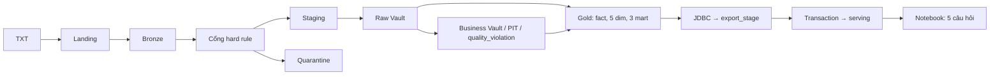

# Review: PRD và Kế hoạch triển khai

Oct 27, 2026 · @Vĩnh

Vòng review đọc chéo PRD và Kế hoạch triển khai, tìm ra 16 vấn đề: 1 lỗi thiết kế nghiêm trọng, 6 chỗ hai tài liệu mâu thuẫn hoặc tự mâu thuẫn, 9 chỗ thiếu hoặc mơ hồ. Vòng 2 (mục 4) bổ sung 4 vấn đề về lập luận chọn Data Vault và quy trình thực thi. Tất cả đã sửa trong hai file; 2 điểm còn phụ thuộc vào spike kỹ thuật tuần 1 (mục 5). Bản gốc trước khi sửa được giữ ở thư mục backup ngoài repo.

## 1. Lỗi thiết kế nghiêm trọng

**R-01. Khóa Satellite trùng khi kỳ nạp là một quý.**
Kỳ nạp là một quý, nên mỗi khoản vay có 3 dòng perf trong một đợt. Nếu cả đợt dùng chung một `load_date`, ba dòng này trùng khóa (`hash_key`, `load_date`) ở `sat_loan_balance` và `sat_loan_delinquency`. Macro `sat` sẽ giữ một dòng và bỏ hai, nên Satellite mất 2/3 lịch sử. AC-04 (PIT khớp Bronze) sẽ sai ở 2/3 số tháng, và thực nghiệm 6 mất ý nghĩa.

*Sửa:* DAG vẫn chạy theo quý, nhưng mỗi tháng báo cáo m trong quý mang `load_date` riêng (ngày 1 của tháng m+1). PIT dùng các `load_date` theo tháng làm mốc as-of. Phương án dự phòng: nếu macro `sat` không xử lý được nhiều `load_date` trong một stage thì chạy dbt Raw Vault 3 lần mỗi kỳ. (PRD mục 4, 6, FR-10, FR-13; Kế hoạch mục 4)

*Phương án đã cân nhắc và không chọn:* đổi kỳ nạp thành một tháng. Cách này đúng về logic nhưng tăng số lần chạy DAG lên khoảng 80 lần, khó đạt mục tiêu 45 phút. Thêm `reporting_period` vào khóa Satellite (multi-active) thì Satellite luôn có dòng mới mỗi tháng, làm mất giá trị của `hash_diff` mà P2 dựa vào.

## 2. Mâu thuẫn

| # | Vấn đề | Sửa |
| --- | --- | --- |
| R-02 | Idempotent "không đổi số dòng ở bảng nào", nhưng FR-02 yêu cầu `load_control` ghi một dòng mỗi lần chạy | Loại trừ `load_control` (là nhật ký chạy) ở G1 và NFR |
| R-03 | FR-01 bỏ qua kỳ đã SUCCESS, nhưng AC-02 và FR-14 cần chạy lại kỳ | `make run PERIOD=` luôn chạy; chỉ `run-all` bỏ qua kỳ đã SUCCESS; FR-14 thành một đợt sửa có `load_date` mới |
| R-04 | AC-08 (MVP tuần 5) cần dashboard hoặc notebook, nhưng kế hoạch để dashboard ở tuần 7 | Tuần 5 làm notebook; dashboard Metabase (Should) ở tuần 7 |
| R-05 | PRD nhắc "code freeze tuần 7" nhưng kế hoạch không có mốc này | Thêm mốc thứ 4 vào mục 6 và 7 |
| R-06 | Thứ tự cắt giảm ở P6 bỏ 1 Satellite Business Vault, trong khi FR-12 là Must | Chỉ cắt các mục Should trước: FR-20 → FR-11 → FR-18 (FR-14 được nâng lên Must ở R-17) |
| R-07 | P5 lập luận nên viết tay nhưng kết luận dùng automate-dv; số "2 phản biện đổi thiết kế" bỏ sót P5 | Viết lại P5; cập nhật số lượng thành 3 (P2, P3, P5) |

## 3. Thiếu hoặc mơ hồ

| # | Vấn đề | Sửa |
| --- | --- | --- |
| R-08 | Chạy lại một kỳ *cũ* sau khi đã nạp kỳ mới hơn: macro `sat` so với phiên bản mới nhất nên có thể chèn lại giá trị cũ | FR-10: bỏ qua dòng có (`hash_key`, `load_date`) đã tồn tại; AC-02 kiểm cả kỳ cũ |
| R-09 | Bronze và quarantine nạp lại có thể nhân đôi dòng | Ghi đè lát của kỳ bằng `replaceWhere` (FR-04, FR-07) |
| R-10 | Không nói rõ orig vào Bronze theo kỳ nào; AC-01 và AC-03 không kiểm được | Lát orig của kỳ là các khoản vay có tháng perf đầu tiên trong quý; AC-03 tính sau kỳ cuối, chỉ trên khoản vay có perf |
| R-11 | 3 mart không trả lời được câu 2 (LTV, DTI) và câu 3 (bên bán) | `mart_delinquency` có thêm chiều bên bán và nhóm LTV, DTI |
| R-12 | Số Satellite lệch (5 hay 6) và chưa đặt tên; số dim lệch (4–5 hay 5) | Đặt tên 5 Satellite; esat ghi là tùy chọn; chốt 5 dim |
| R-13 | Hash: `sha2` hay `md5`, dấu phân cách và cách xử lý null chưa chốt | sha2-256, `\|\|`, null thành `^^`; thêm test thứ tự null |
| R-14 | "4 phép đối soát" ở G2 không chỉ rõ là những AC nào | Ghi rõ AC-01, 03, 05, 06 |
| R-15 | Giả thuyết thực nghiệm 1 "tuyến tính nhờ phân tán" không đúng trên một máy; quy tắc đo chưa xử lý cache, lần khởi động | Viết lại giả thuyết theo điểm nghẽn từng tầng; xóa cache, bỏ lần đầu, báo cáo trung vị |
| R-16 | Spike automate-dv và việc kiểm dung lượng bộ đầy đủ là điều kiện tuần 1 nhưng không có trong giai đoạn 0; PostgreSQL phục vụ dùng chung với Metastore | Thêm vào giai đoạn 0; tách database `analytics` |

## 4. Vòng 2: lập luận chọn Data Vault và quy trình thực thi

Câu hỏi đặt ra: Data Vault có phải lựa chọn mô hình sai cho use case này không? Kết luận: không. Các chỗ thiếu ở vòng 1 (từ điển dữ liệu, định nghĩa nghiệp vụ, luật chất lượng) mô hình nào cũng cần, và Data Vault đáp ứng đúng nhu cầu truy vết của nhóm kiểm toán. Tuy nhiên, lập luận bảo vệ lựa chọn này đang mỏng hơn mức tài liệu tự nhận.

| # | Vấn đề | Sửa |
| --- | --- | --- |
| R-17 | Kịch bản duy nhất cho thấy Data Vault làm được điều star schema ghi đè không làm được (FR-14) lại là Should, dễ bị cắt đầu tiên | FR-14 lên Must; thêm AC-09 và bảng đối chứng `baseline_dim_loan_overwrite` |
| R-18 | P1 dùng thực nghiệm 4 làm bằng chứng, nhưng thực nghiệm này chỉ so hai cách truy vấn bên trong Data Vault | Sửa P1: bằng chứng là đợt sửa dữ liệu (AC-09) |
| R-19 | Chưa trả lời câu "sao không dùng Delta time travel?" | Thêm phản biện P8 và câu vấn đáp tương ứng |
| R-20 | PRD sẽ thay đổi khi thực thi nhưng chưa có quy trình; các giai đoạn chưa có điều kiện cụ thể để đi tiếp | PRD mục 8 (quản lý thay đổi, lịch sử phiên bản); Kế hoạch mục 6 thêm cổng C0–C7, mỗi cổng gắn với AC/FR và có lệnh `make gate` |

## 5. Còn mở, chờ spike tuần 1

- [x] Macro `sat` của automate-dv trên dbt-spark có xử lý được nhiều `load_date` trong một stage không (quyết định cách giải R-01). Có, xem R-26
- [x] Macro `sat` có bỏ qua dòng đã tồn tại khi chạy lại kỳ cũ không, hay cần bọc thêm bộ lọc (R-08). Không, cần bật bộ lọc `valid_stg`, xem R-26

## 6. Vòng 3: phát hiện từ File Layout Release 47 và bộ mẫu (giai đoạn 0)

Ngày 27/10/2026, khi lập từ điển dữ liệu (`docs/tu-dien-du-lieu.md`), đọc File Layout Release 47 và khám phá bộ mẫu cho thấy một giả định kiến trúc sai và ba điểm cần chốt. PRD lên bản 1.3.

| # | Vấn đề | Quyết định |
| --- | --- | --- |
| R-21 | Release 47 chuyển Servicer Name từ orig sang perf (vị trí 34). Thiết kế cũ lấy `hub_servicer`, `link_loan_servicer` từ orig. Trên bộ mẫu, 18.774 khoản vay (37,5%) đổi servicer, 2.368 khoản vay quay lại servicer cũ | `hub_servicer` và `link_loan_servicer` nạp từ perf. FR-11 (`esat_loan_servicer`) giữ mức Should nhưng nay có dữ liệu để làm. Nếu cắt FR-11, Gold gắn mỗi khoản vay với servicer đầu tiên trong Link và ghi hạn chế, vì Link không biểu diễn được A → B → A. *Phương án không chọn:* nâng FR-11 lên Must (tăng phạm vi khi nhóm chỉ còn một người, xem R-25); bỏ `hub_servicer` và để servicer là thuộc tính Satellite (làm yếu mô hình) |
| R-22 | Seller và servicer dưới ngưỡng 1% UPB của quý bị gộp thành `OTHER` (33,7% khoản vay ở seller) | Giữ `OTHER` là một khóa Hub; mart và báo cáo ghi rõ đây không phải một tổ chức. Rủi ro ở mục 10 Kế hoạch chuyển thành hạn chế đã biết |
| R-23 | Trong forbearance COVID, mã quá hạn vẫn tăng. Định nghĩa vỡ nợ "180 ngày trở lên" cho 1.701 khoản vay, bỏ các tháng forbearance thì còn 926 | Vỡ nợ = quá hạn 180+ ngoài tháng forbearance, hoặc `RA`, hoặc ZBC `02`/`03`/`09` (từ điển dữ liệu mục 4) |
| R-24 | Bộ mẫu có 29 kỳ (2019Q1–2026Q1), 87 `load_date`. Mục tiêu 45 phút tương đương khoảng 1,5 phút mỗi kỳ | Không đổi mục tiêu lúc này; baseline ở C1 quyết định. Nếu không đạt, điều chỉnh theo PRD mục 8 |

## 7. Kết luận spike C0 (29/10/2026)

Spike ở `experiments/spike_c0/`: Spark Thrift Server (Delta, metastore Derby nhúng) và dbt-spark nạp `hub_loan`, `sat_loan_balance` cho tháng 201904 và 201905 của bộ mẫu. Lệnh `make gate N=0` chạy lại 6 kiểm thử.

**R-26. automate-dv chạy được trên dbt-spark, nhưng cần một lớp tương thích.**

| Phát hiện | Quyết định |
| --- | --- |
| automate-dv 0.11.5 chỉ có macro `databricks__*`. Adapter dbt-spark tìm `spark__*` rồi `default__*` (SQL kiểu Snowflake), nên lỗi ngay ở bước compile | Sinh tự động 24 macro `spark__X` gọi `databricks__X` (`gen_shim.py`); chạy lại khi đổi phiên bản automate-dv |
| Bản Databricks của `hub`, `link`, `sat`, `eff_sat` dùng `QUALIFY`. Spark mã nguồn mở 3.5 và 4.1 đều không hỗ trợ cú pháp này | Viết tay `spark__hub`, `spark__sat` (thay `QUALIFY` bằng truy vấn con, giữ nguyên logic); `link` làm ở C2. Nhóm phải giải thích được SQL của các macro này khi vấn đáp (P5) |
| Spark 3.5.7 + Delta 3.3.2 lỗi ở `CREATE OR REPLACE TABLE AS SELECT`, câu lệnh dbt-spark dùng khi tạo bảng | Chốt Spark 3.5.5, Delta 3.3.2, dbt-core 1.12.5, dbt-spark 1.11.0, automate_dv 0.11.5 |
| R-01: macro `sat` so `hash_diff` với dòng liền trước theo `load_date` ngay trong stage, nên nạp nhiều tháng một lần vẫn đúng (28.069 dòng Satellite = 28.069 dòng perf) | Không cần chạy dbt Raw Vault 3 lần mỗi kỳ; bỏ phương án dự phòng ở PRD mục 6 |
| R-08: không có bộ lọc, chạy lại tháng 201904 sau 201905 chèn lại 12.042 dòng trùng khóa, vì dòng cũ bị so với phiên bản mới nhất | Bật `apply_source_filter`: chỉ nhận dòng của khóa mới hoặc có `load_date` sau phiên bản mới nhất. Sửa câu chữ FR-10 cho khớp |
| Hash lưu dạng chuỗi hex in hoa 64 ký tự: `UPPER(SHA2(UPPER(TRIM(x)), 256))` | Ghi vào FR-06; test hash và các phép join so theo kiểu chuỗi |

*Phương án đã cân nhắc và không chọn:* bỏ automate-dv, tự viết toàn bộ macro (mất phần staging, hash, PIT đã chạy được); chuyển sang Databricks (trái với yêu cầu chạy cục bộ, không dùng cloud trả phí).

*Hệ quả của bộ lọc R-08:* dữ liệu đến trễ của một tháng cũ bị bỏ qua thay vì được chèn vào giữa lịch sử. Đây là chủ ý: nếu chèn vào giữa, phép so `hash_diff` sẽ so với sai phiên bản. Đợt sửa dữ liệu FR-14 dùng `load_date` mới nên không bị ảnh hưởng.

## 8. Vòng 4: làm một người (29/10/2026)

**R-25. Điều kiện chốt "nhóm từ 3 người" không đạt.** Đồ án làm một người, môn Kỹ thuật xử lý dữ liệu, 10–15 giờ/tuần. Ước tính cho phạm vi bản 1.4 là 100–110 giờ, vượt sức chứa khi một người làm.

| Thay đổi | Lý do | Ảnh hưởng |
| --- | --- | --- |
| Cắt FR-11 (`esat_loan_servicer`), FR-18 (dashboard Metabase), FR-20 (thực nghiệm 3, 5) | Ba mục Should, theo đúng thứ tự cắt giảm ở P6; tiết kiệm khoảng 12–18 giờ. `eff_sat` còn cần viết tay macro không dùng `QUALIFY` (R-26) | Không biết servicer theo từng tháng; câu hỏi 1–5 vẫn trả lời đủ qua notebook (AC-08); còn 4 thực nghiệm bắt buộc |
| Giữ nguyên Raw Vault: 3 Hub, 2 Link, 5 Satellite | Spike cho thấy mỗi bảng chỉ là một lời gọi macro (khoảng 1 giờ kể cả test); cắt còn 2 Hub, 1 Link, 3 Satellite chỉ tiết kiệm 3–5 giờ | `link_loan_servicer` vẫn ghi nhận mọi cặp khoản vay × servicer, dùng làm ví dụ lịch sử khi vấn đáp |
| Bỏ MinIO: Delta lưu trên volume cục bộ, đường dẫn trong `conf/pipeline.yml` | Bớt một service, bớt hadoop-aws và cấu hình `s3a://`, là rủi ro phiên bản đã nêu ở mục 10 Kế hoạch | NFR "Khả chuyển" đổi: chuyển sang S3 hoặc MinIO chỉ đổi cấu hình và thêm hadoop-aws |
| Airflow chạy LocalExecutor, DAG tuyến tính | Đỡ RAM, đỡ cấu hình | Không ảnh hưởng FR-21 |
| AC-07, NFR "Tái lập", cổng C4, C6: "một thành viên khác chạy lại theo README" thành "chạy lại theo README từ một bản clone sạch, sau `docker compose down -v`" | Không có thành viên khác | Tiêu chí yếu hơn: cùng máy, cùng người. Báo cáo ghi rõ hạn chế này |

*Phương án đã cân nhắc và không chọn:* thu Raw Vault còn 2 Hub, 1 Link, 3 Satellite theo phương án "nhóm 2 người" ở mục 12 Kế hoạch (tiết kiệm ít, mất ví dụ servicer); bỏ Airflow, chạy bằng script (trái quyết định đã chốt về điều phối, và FR-21 là Must).

**Hạn nộp:** C0 trễ khoảng 3 tuần so với kế hoạch (bắt đầu 03/10/2026). Ngày 29/10/2026 chủ repo quyết định không cắt thêm: giữ phạm vi trên, làm đầy đủ.

## 9. Giai đoạn 1: quyết định hạ tầng và Bronze (29/10/2026)

**R-27.** Các quyết định khi dựng `docker-compose.yml` và job Bronze. Không đổi FR hay AC, nhưng đổi kiến trúc ở mục 5 Kế hoạch.

| # | Quyết định | Lý do | Phương án không chọn |
| --- | --- | --- | --- |
| 1 | Không dựng Spark standalone cluster (Kế hoạch ghi 1 master + 2 worker). Hai Spark local mode, mỗi cái một JVM: Thrift Server cho dbt (`local[4]`, 3 GB) và job PySpark trong container Airflow scheduler (3 GB). Hai bên dùng chung Hive Metastore và volume `/lake` | Thrift Server chạy trên cluster sẽ giữ executor suốt thời gian sống và tranh tài nguyên với job Bronze. Trên một máy, cluster không thêm năng lực tính toán, chỉ thêm JVM và RAM | Standalone cluster với dynamic allocation (phức tạp, tốn RAM với 12 GB) |
| 2 | Airflow 3.3.2, LocalExecutor, tách api-server, scheduler, dag-processor; đăng nhập bằng FAB auth manager. Task chạy trong container scheduler nên image có Java 17 và PySpark 3.5.5 | Bản 3.x hiện hành; bản 2.x đã hết hỗ trợ | `airflow standalone` (gộp mọi thứ, chỉ dành cho thử nghiệm) |
| 3 | Hive Metastore 3.1.3 trên PostgreSQL, với script khởi động tự viết | Client Hive tích hợp trong Spark 3.5 là 2.3.9, tương thích metastore 3.1. Entrypoint gốc chạy `-initSchema` mỗi lần khởi động và thoát khi schema đã có | Metastore 4.0 (rủi ro tương thích với client 2.3.9); Derby nhúng (không dùng chung được giữa hai JVM) |
| 4 | `load_control` là bảng `control.load_control` trong database `analytics` (PostgreSQL) | Airflow đọc và ghi nhật ký chạy mà không cần khởi động Spark; báo cáo chất lượng (G5) đọc bằng SQL | Bảng Delta (mỗi lần ghi nhật ký phải khởi động một SparkSession) |
| 5 | Bronze giữ mọi cột dạng chuỗi, thêm `_field_count` và `_raw` (dòng gốc, chỉ khi số trường lệch). File được đọc dạng text rồi tách theo dấu `\|` | Cổng chất lượng (FR-07) cần thấy giá trị sai kiểu và dòng sai số trường. Reader CSV với schema cố định tự lấp null hoặc cắt bớt trường, làm mất bằng chứng | Ép kiểu ở Bronze; reader CSV với `columnNameOfCorruptRecord` (không bắt được dòng thừa trường) |
| 6 | Bảng Bronze là bảng Delta được quản lý trong database `bronze` của metastore, phân vùng theo `period`; ghi đè lát bằng `replaceWhere` | dbt (C2) đọc Bronze qua metastore; phân vùng theo kỳ giúp `replaceWhere` chỉ chạm một thư mục | Bảng theo đường dẫn (dbt khó tham chiếu) |
| 7 | Mọi container chạy uid 1000 | Tránh lỗi quyền giữa Hive, Spark và Airflow trên cùng thư mục `data/lake` | Chạy root (file trên máy thuộc root, khó xóa) |

**Hệ quả cần theo dõi:** mỗi lần chạy Bronze phải quét toàn bộ file perf, để lấy lát tháng và để tìm tháng perf đầu tiên của từng khoản vay (lát orig, R-10). Trên bộ đầy đủ (8 GB) điều này lặp lại ở cả 29 kỳ. Đã xử lý ở R-28.

**R-28. Tầng landing: chuyển file TXT sang Delta một lần cho mỗi bộ dữ liệu.**

| Vấn đề | Quyết định |
| --- | --- |
| Bronze đọc thẳng file TXT ở mỗi kỳ. File là một khối không phân vùng, nên mỗi kỳ quét toàn bộ file hai lần (lấy lát tháng, tìm tháng perf đầu tiên cho lát orig). Trên bộ đầy đủ là 8 GB × 2 × 29 kỳ | Thêm `ingestion/landing.py`: đọc TXT một lần, ghi `landing.<source>_orig`, `landing.<source>_perf` (phân vùng theo tháng báo cáo, mỗi tháng một file) và `landing.<source>_loan_first_month`. Bronze đọc từ landing, mỗi kỳ chỉ đọc 3 thư mục tháng |
| Landing phải luôn khớp với nguồn và schema | Dấu vân tay (tên, kích thước, thời điểm sửa của file TXT và nội dung `conf/schema`) lưu trong file trạng thái nằm trong thư mục database landing. Task `landing` của DAG chỉ dựng lại khi dấu vân tay đổi; nếu không đổi thì không khởi động Spark (0,3 giây) |
| Landing không được làm mất bằng chứng cho cổng chất lượng | Giữ nguyên quy tắc của Bronze: mọi cột dạng chuỗi, `_field_count`, `_raw`, `source_file` trỏ về file TXT gốc. AC-01 vẫn đối chiếu với file TXT gốc |

*Số đo trên bộ mẫu (29/10/2026):* dựng landing một lần mất 27 giây. Task Bronze mỗi kỳ: 25,9 giây (trung vị 13 kỳ) khi đọc TXT, 23,5 giây khi đọc landing. Đo tách từng bước cho thấy trên bộ mẫu thời gian chủ yếu là chi phí cố định của Spark: truy vấn đầu tiên trong JVM mất khoảng 9 giây khởi động nguội, còn khi đã "nóng" thì đọc lát perf 0,5 giây và lát orig 0,8 giây. Ước tính ban đầu "landing giảm còn 8–12 giây mỗi kỳ trên bộ mẫu" là sai. Giá trị của landing nằm ở bộ đầy đủ, nơi phần đọc dữ liệu tăng khoảng 36 lần; thực nghiệm 1 (C5) đo con số này.

*Phương án không chọn:* cache dữ liệu perf trong một job (chỉ gộp hai lượt quét thành một, vẫn quét toàn bộ file mỗi kỳ); một SparkSession sống lâu cho mọi kỳ (giảm chi phí khởi động, nhưng phá cấu trúc một DAG run cho một kỳ và việc chạy lại từng kỳ, FR-21).

*Sửa kèm:* Delta cập nhật schema bảng trong metastore sau mỗi lần ghi; metastore 3.1 mặc định từ chối (`hive.metastore.disallow.incompatible.col.type.changes`) và Delta in stack trace dài (không làm hỏng dữ liệu). Đặt cấu hình này thành `false` để log sạch.

## 10. Giai đoạn 2: cổng chất lượng và Raw Vault (30/10/2026)

**R-29.** Các quyết định khi cài cổng chất lượng (FR-07) và Raw Vault. Không đổi FR hay AC.

| # | Quyết định | Lý do |
| --- | --- | --- |
| 1 | Cổng chất lượng ghi `quality.<x>_clean` (dòng hợp lệ, giữ dạng chuỗi như Bronze) và `quality.<x>_quarantine` (thêm `_reject_reason`, `_reject_column`), phân vùng theo kỳ, ghi đè lát bằng `replaceWhere` | dbt chỉ đọc bảng clean nên dòng lỗi không thể vào Raw Vault; AC-06 kiểm được bằng phép cộng; chạy lại kỳ không nhân đôi (R-09) |
| 2 | Luật đọc từ `conf/schema` (`type`, `domain`, `values`, `missing`, `pattern`, `nullable`), không viết cứng trong code | Từ điển, schema và cổng chất lượng không thể lệch nhau; đổi luật chỉ sửa `conf/` (FR-03) |
| 3 | Mỗi dòng lỗi mang một lý do chính, theo thứ tự: sai số trường, sai khóa, sai kiểu, ngoài miền, trùng khóa, mồ côi | Dòng thiếu trường thì các luật sau vô nghĩa; báo nhiều lý do làm báo cáo chất lượng (G5) đếm trùng |
| 4 | Trùng khóa: chặn mọi bản sao, nhưng chỉ đếm giữa các dòng đã qua luật trên từng dòng | Không biết bản nào đúng; một bản hỏng kiểu không làm bản đúng bị chặn oan |
| 5 | Cột không khai báo `nullable` mà rỗng thì bị chặn với lý do `ngoai_mien` | Thiếu giá trị bắt buộc là một dạng ngoài miền; không thêm lý do mới |
| 6 | Mồ côi so với orig ở Bronze của mọi kỳ đến kỳ hiện tại | Lát orig của một khoản vay nằm ở kỳ có tháng perf đầu tiên, luôn không muộn hơn kỳ của dòng perf. Hệ quả: phải nạp các kỳ theo thứ tự thời gian (`make run-all` đã làm vậy); nạp một kỳ muộn trước kỳ sớm hơn sẽ chặn oan dòng perf |
| 7 | Model `base_orig`, `base_perf` (ép kiểu, đổi mã thiếu thành null) sinh từ `conf/schema` bằng `scripts/gen_dbt_staging.py`; unit test kiểm file sinh ra luôn khớp conf | Viết tay 66 cột với mã thiếu sẽ lệch ngay khi sửa conf. Số tiền dùng `DECIMAL(20, 4)` để tổng dư nợ ở Gold khớp chính xác Bronze (AC-05) |
| 8 | `sat_loan_termination` chỉ nhận dòng có sự kiện kết thúc (`zero_balance_code` hoặc `defect_settlement_date` có giá trị) | Các tháng khác có mọi cột kết thúc đều null; nếu đưa vào, mỗi khoản vay có thêm một phiên bản "toàn null" vô nghĩa |
| 9 | `link` viết lại cùng lõi với `hub` (`_spark_insert_new_keys`), không dùng `QUALIFY` (tiếp R-26) | Hai macro chỉ khác điều kiện khóa ngoại khác null |
| 10 | dbt cài trong virtualenv riêng `/opt/dbt-venv` của image Airflow | dbt-core và Airflow ràng buộc khác nhau trên thư viện dùng chung |
| 11 | `dbt-core-experimental-parser` (phụ thuộc của dbt-core 1.12) chỉ có sdist, lúc cài tải wheel 55 MB từ GitHub Releases. Wheel được tải sẵn vào `docker/airflow/wheels/` (kiểm sha256 theo `assets.json` của gói, không đưa vào git) và cài qua `--find-links` | Mạng tới GitHub Releases ngày 30/10 chỉ khoảng 40 KB/s, build treo. Thư mục rỗng thì pip tải như thường, nên không mất tính tái lập |
| 12 | Một kỳ chỉ được coi là đã nạp xong khi có lần chạy SUCCESS đã qua cổng chất lượng (`rows_clean` có giá trị) | Các lần chạy của DAG giai đoạn 1 chưa có cổng chất lượng và Raw Vault; `make run-all` phải chạy lại chúng |
| 13 | Unit test hash (FR-06) chạy trên SQL thật do automate_dv sinh ra (seed `hash_cases` và test `assert_hash_rules`), không viết lại thuật toán bằng Python | Viết lại bằng Python chỉ chứng minh bản Python đúng, không chứng minh dbt đúng |

**R-30. Staging lưu thành bảng thay vì view.**

| Vấn đề | Quyết định |
| --- | --- |
| Từ kỳ thứ hai, `sat_loan_property` và `sat_loan_origination` (incremental) chạy hơn 3 phút rồi làm Thrift Server tràn heap 3 GB và tắt (hai lần ngày 30/10, kỳ 2019Q2), dù dữ liệu của kỳ chỉ vài chục nghìn dòng. Riêng `EXPLAIN` (chỉ lập kế hoạch) đã mất 63 giây và đẩy bộ nhớ Thrift lên gần 3 GB. Nguyên nhân: Spark không lưu tạm CTE và view mà chép cây biểu thức gốc ở mỗi chỗ tham chiếu. Macro `sat` incremental tham chiếu stage 5 lần, mỗi bản chép mang theo 31 biểu thức `CASE` của `base_*` và các hash `CONCAT_WS` nhiều cột | `stg_orig`, `stg_perf`, `stg_perf_termination` là bảng Delta ghi lại mỗi lần chạy (chỉ chứa kỳ đang nạp); `base_*` vẫn là view. `EXPLAIN` cùng câu lệnh còn 3 giây. Hash chỉ tính một lần cho cả 10 model Raw Vault |
| Spike C0 không bắt được lỗi này | Staging của spike chỉ hash 9 cột và không có lớp `base` ép kiểu. Bài học cho C3 (PIT, Business Vault): model incremental nào tham chiếu nguồn nhiều lần thì nguồn đó phải là bảng |

Kèm theo: giới hạn lịch sử truy vấn của Spark UI (`spark.sql.ui.retainedExecutions` và các cấu hình liên quan trong `docker/spark/conf/spark-defaults.conf`). Đây là biện pháp phòng ngừa cho Thrift Server chạy lâu, không phải nguyên nhân của lần tràn heap trên; chẩn đoán ban đầu "do tích dồn lịch sử" là chưa đúng.

Kế hoạch mục 3 ghi "Staging là view dbt, không lưu bền": nay staging của Raw Vault là bảng tạm, ghi đè mỗi lần chạy, vẫn không giữ lịch sử.

## 11. Giai đoạn 3: Business Vault, PIT và đợt sửa dữ liệu (30/10/2026)

**R-31.** Các quyết định khi cài Business Vault (FR-12), PIT (FR-13) và đợt sửa dữ liệu (FR-14). Không đổi FR hay AC; điểm 1 đổi cách cài đặt ghi ở Kế hoạch mục 6 ("macro `pit` của automate-dv").

| # | Quyết định | Lý do |
| --- | --- | --- |
| 1 | `pit_loan_monthly` viết bằng SQL, không dùng macro `pit` của automate-dv. Mốc là các tháng khoản vay có dòng perf, cộng `load_date` của orig; nạp tăng dần theo kỳ; với phiên bản trước kỳ chỉ lấy phiên bản cuối cùng của mỗi khoản vay | Macro dựng tích chéo mọi khoản vay × mọi mốc và dựng lại mỗi lần chạy: bộ đầy đủ 1,78 triệu × 87 mốc = 155 triệu dòng. Cách tự viết tăng tuyến tính theo dữ liệu |
| 2 | Thứ tự: Raw Vault → PIT → `bsat_loan_risk` → `bsat_loan_lifecycle`. PIT chỉ trỏ tới 5 Satellite của Raw Vault; hai Satellite tính toán có cùng hạt với PIT (khoản vay × tháng có perf) nên Gold join theo (`LOAN_HK`, `load_date`) | Tránh vòng phụ thuộc: Business Vault cần trạng thái theo tháng lấy qua PIT |
| 3 | `months_delinquent_consecutive`, `ever_d90`, `default_load_date` nối qua ranh giới kỳ bằng "hạt giống" là dòng cuối trước kỳ trong chính bảng; chuỗi quá hạn đánh mã bằng tổng tích lũy số tháng không quá hạn | Mỗi kỳ chỉ xử lý các tháng của kỳ thay vì quét lại toàn bộ lịch sử. Hệ quả: nạp các kỳ theo thứ tự thời gian (như luật mồ côi, R-29) |
| 4 | `bsat_loan_lifecycle` tách `MATURED` (ZBC 01 từ ngày đáo hạn) khỏi `PREPAID` (ZBC 01 trước ngày đáo hạn) | Từ điển định nghĩa trả trước hạn là `zero_balance_date` trước `maturity_date`; vintage 2019 trên bộ mẫu chưa có khoản nào `MATURED` |
| 5 | FR-12 nghiệm thu bằng cách tính độc lập bằng Python thuần trên file TXT (`tests/gates/c3/oracle.py`), so mọi tháng của 20 khoản vay chọn theo seed, 4 khoản mỗi nhóm (vỡ nợ, từng 90+, hoãn trả COVID, trả trước hạn, luôn đúng hạn). Kế hoạch ghi "tính tay"; cách này chặt hơn (mọi tháng thay vì vài điểm) và giá trị kỳ vọng không lưu trong repo vì chứa mã khoản vay thật | Hai cách tính không dùng chung code. Thử trước trên 2019Q1–Q2: 58.267 dòng, 0 lệch, kể cả các tháng ở ranh giới kỳ |
| 6 | Đợt sửa CORR1 khai báo trong `conf/pipeline.yml` (20 khoản vay theo seed, `credit_score` +20, `orig_dti` −5, `load_date` 2026-05-01, `record_source` riêng), sinh từ Bronze lúc chạy và nạp như một kỳ (`make correction`). Chỉ chọn khoản vay có giá trị sau sửa còn trong miền | Không lưu dữ liệu thật trong repo; chạy lại cho cùng kết quả; giá trị cũ và mới chắc chắn khác nhau |
| 7 | `baseline.baseline_dim_loan_overwrite`: model dbt `merge` theo `LOAN_HK` (SCD1) từ `stg_orig`, chỉ để đối chứng | Cùng đợt sửa nạp vào hai nơi; AC-09 so hai bên |
| 8 | `load_control.layers` ghi các tầng DAG đã đi qua khi SUCCESS; kỳ chỉ coi là đã nạp xong khi lần chạy qua đủ các tầng hiện có (`PIPELINE_LAYERS`) | Thay cho điều kiện `rows_clean IS NOT NULL` ở R-29; thêm tầng Gold ở C4 thì `make run-all` tự chạy lại mọi kỳ |
| 9 | View `base_*` không lọc theo kỳ; bộ lọc `var('period')` nằm ở bảng `stg_*` | Trong view, bộ lọc bị đóng băng lúc tạo view; một lần chạy dbt chọn lọc không dựng lại view đã đọc nhầm kỳ 2019Q3 mà không báo lỗi (phát hiện khi thử Business Vault ngày 30/10). Không dùng `ephemeral` được vì `automate_dv.stage` cần đọc danh sách cột của nguồn |

**R-32. Mỗi tầng của mỗi kỳ là một đơn vị chạy độc lập.**

| Vấn đề | Quyết định |
| --- | --- |
| Khi thêm tầng Business Vault, `make run-all` chạy lại cả 29 kỳ từ landing: mỗi kỳ khoảng 3,8 phút, trong đó Bronze, cổng chất lượng và Raw Vault (khoảng 3 phút) cho kết quả y hệt, chỉ Business Vault (36 giây) là việc mới. Idempotent chỉ bảo đảm chạy lại thì an toàn, không phải lý do để chạy lại | DAG nhận conf `layers`; tầng không được chọn bị skip (task Python ném `AirflowSkipException`, task dbt thoát mã 99). `trigger_rule = none_failed` để task sau vẫn chạy khi tầng trước bị skip nhưng không chạy khi tầng trước lỗi (FR-22 giữ nguyên) |
| Phải biết mỗi kỳ đã có tầng nào | `load_control.layers` ghi các tầng lượt chạy đã thực sự chạy; một kỳ có tầng nào là hợp các lượt SUCCESS. `make run-all` chạy từ tầng đầu tiên còn thiếu đến hết (các tầng sau phụ thuộc dữ liệu vào nó). `make run PERIOD=...` vẫn chạy đủ mọi tầng, để kiểm idempotent (AC-02) có ý nghĩa |
| Lượt chạy trước khi có cột `layers` | Suy ra một lần từ dấu vết sẵn có: có `rows_clean` là DAG giai đoạn 2 (đến Raw Vault), không có là DAG giai đoạn 1 (đến Bronze) |
| Business Vault lấy lưới khoản vay × tháng từ bảng `stg_*` do task `raw_vault` dựng; khi chỉ chạy Business Vault, `stg_*` còn là của lượt trước | Task `business_vault` dựng lại `stg_orig`, `stg_perf` cho kỳ của nó (khoảng 5–8 giây) |

Kết quả: bù tầng Business Vault cho một kỳ mất khoảng 1,5 phút thay vì 3,8 phút. Tính đúng của các tầng cũ do cổng của chúng bảo đảm; `make test` chạy lại các cổng đã qua để bắt hồi quy.

## 12. Vòng 5: đối chiếu chuẩn Data Vault 2.0 và triển khai lại (30/10/2026)

**R-33.** Đối chiếu kiến trúc với chuẩn Data Vault 2.0 (`docs/danh-gia-kien-truc-dv2.md`, có trích dẫn nguồn) phát hiện hai chỗ lệch nghiêm trọng và bốn chỗ lệch mức trung bình. Chủ repo quyết định triển khai lại từ trạng thái sạch theo kiến trúc đúng chuẩn và ghi lại bài học kinh nghiệm. PRD lên 1.6.

| # | Lệch chuẩn | Quyết định |
| --- | --- | --- |
| 1 | PIT và Business Vault đọc bảng staging `stg_*` (bảng tạm, ghi đè mỗi lần chạy) để biết khoản vay nào có báo cáo tháng nào. Chuẩn: Business Vault dựng từ Raw Vault | Thêm record tracking satellite `xts_loan` (macro `xts` của automate-dv) ghi mỗi lần khoản vay và cặp khoản vay–servicer xuất hiện trong một lần nạp. PIT và Business Vault chỉ đọc Raw Vault |
| 2 | Cổng chất lượng chặn cả soft rule (ngoài miền, mồ côi) trước Raw Vault. Chuẩn: trước Raw Vault chỉ áp hard rule; soft rule ở downstream | Hard rule (sai số trường, sai khóa, sai kiểu, trùng khóa khác giá trị) vào error mart; bản sao giống hệt được khử trùng lặp; soft rule không chặn, ghi vào báo cáo vi phạm `quality.<x>_soft_violation`. Luật mồ côi không còn chặn nên cổng chất lượng không còn phụ thuộc thứ tự thời gian |
| 3 | `load_date` mang nghĩa ngày nghiệp vụ; chạy lại kỳ cũ làm `load_date` lùi | Giữ `load_date` là thời điểm đến giả lập của lần giao tháng (phát lại lịch sử theo thứ tự thời gian). Satellite perf thêm `reporting_period` làm applied date (không tính vào `hash_diff`). Bộ lọc `apply_source_filter` giữ như điều kiện kỹ thuật (delta check) |
| 4 | Lọc nghiệp vụ khi nạp `sat_loan_termination` | Bỏ; `hash_diff` tự loại các tháng không đổi |
| 5 | PIT không có snapshot table, con trỏ null | Snapshot table `as_of_dates` (mỗi tháng một mốc, lấy từ `xts_loan`); ghost record ở mọi Satellite; PIT có cặp con trỏ (hash key, `load_date`) cho mỗi Satellite, trỏ tới ghost record khi chưa có phiên bản. Giữ cách nạp tăng dần của R-31 |
| 6 | Link khoản vay–servicer không có thông tin hiệu lực theo tháng | `xts_loan` ghi cặp khoản vay–servicer có mặt ở mỗi lần nạp, đủ để Gold biết servicer của tháng m mà không cần khôi phục FR-11 |
| 7 | Điều phối một DAG chạy cả luồng (R-32) | Mỗi tầng một DAG chạy định kỳ, chọn việc từ bảng điều khiển `control.layer_run` (khóa dòng, hạn thuê cho dòng RUNNING, giới hạn số lần thử, pool một job Spark và một lệnh dbt) |

*Phạm vi triển khai lại:* xóa toàn bộ dữ liệu và metadata (`docker compose down -v`, `data/lake`), nạp lại từ landing. Viết lại cổng chất lượng, Raw Vault, PIT, Business Vault và điều phối; giữ cấu hình, landing, Bronze và staging (được đánh giá đúng chuẩn). Chạy lại cổng C1–C3 trên môi trường sạch.

### Bài học kinh nghiệm

Ghi lại để đưa vào báo cáo (chương Hạn chế và hướng phát triển) và để không lặp lại ở các giai đoạn sau.

1. **Đối chiếu chuẩn trước khi cài đặt, không phải sau.** Thiết kế ở giai đoạn 0 dựa trên hiểu biết chung về Data Vault mà không tra tài liệu gốc. Hai lỗi nghiêm trọng (Business Vault đọc staging, soft rule chặn Raw Vault) đều là những điểm mà tài liệu chuẩn nói rõ. Chi phí: viết lại ba tầng và chạy lại ba cổng.
2. **Spike phải kiểm cả nguyên tắc kiến trúc, không chỉ kiểm công cụ.** Spike C0 trả lời "automate-dv có chạy trên Spark không" nhưng không hỏi "luồng dữ liệu giữa các tầng có đúng chuẩn không".
3. **Một chỗ lấp tạm thường che một chỗ thiếu trong mô hình.** Business Vault đọc staging vì Raw Vault thiếu thông tin "khoản vay có mặt trong lần nạp nào". Cách đúng là bổ sung mô hình (record tracking satellite), không đi đường tắt qua tầng khác.
4. **Trạng thái dùng chung giữa các tầng là nguồn lỗi lặng lẽ.** Ba lỗi trong giai đoạn 2–3 (view đóng băng bộ lọc kỳ, `stg_*` của kỳ trước, staging bị ghi đè khi chạy song song) đều không báo lỗi mà cho dữ liệu sai. Mỗi tầng chỉ nên đọc dữ liệu bền vững của tầng dưới.
5. **Idempotent là điều kiện an toàn, không phải lý do để chạy lại.** Chạy lại cả luồng khi chỉ thêm một tầng tốn gần 2 giờ (R-32). Tầng đã xong thì giữ nguyên; tính đúng của nó do cổng của nó bảo đảm.
6. **Thử nhỏ trước khi chạy dài.** Các lần bắt lỗi rẻ nhất đều đến từ thử một hai kỳ trước khi chạy cả 29 kỳ (oracle so 58.267 dòng, `EXPLAIN` 63 giây, smoke trên fixture).

## 13. Vòng 6: tăng tốc dựng model và hoàn thiện chuẩn (30/10/2026)

**R-34. Xử lý theo lô ở tầng cần thứ tự thời gian.** Lần chạy đủ 29 kỳ sau R-33 mất 47 phút 49 giây; Raw Vault trung bình 59 giây mỗi kỳ, Business Vault 31 giây, phần lớn là chi phí cố định của khoảng 100 câu SQL mỗi lần `dbt build` chứ không phải khối lượng dữ liệu. Quyết định:

- `ingestion.control.ready_batch` (hàm thuần, có unit test) gom các kỳ liên tiếp đã sẵn sàng của `raw_vault` và `business_vault` thành một lô, tối đa `orchestration.max_periods_per_batch` (40) kỳ. Một lô dừng ở kỳ đầu tiên chưa sẵn sàng, không bao giờ chứa đợt sửa dữ liệu (đợt sửa có `load_date` riêng nên luôn đi một mình), và bị cắt khi các yêu cầu có `options` khác nhau. Tầng `ingest`, `quality` vẫn mỗi lần một kỳ.
- dbt nhận `--vars {"periods": [...]}`; `stg_*` lọc theo danh sách kỳ. Mỗi kỳ trong lô vẫn có một dòng `control.layer_run` riêng (ghi kèm `details.batch`), nên điều kiện sẵn sàng và kiểm toán theo kỳ không đổi.
- Satellite so `hash_diff` với phiên bản liền trước theo (`hash_key`, `load_date`) trong cùng lần nạp; dòng đầu lô so với phiên bản mới nhất đã có, theo tài liệu [AutomateDV Loading](https://automate-dv.readthedocs.io/en/latest/best_practises/loading/) (base loads và incremental load). `load_date` vẫn chỉ đi tới (DV-04). Làm rõ nguồn khi tiếp quản ngày 30/10/2026: dự án dùng `incremental` và cơ chế gom lô riêng, không dùng `vault_insert_by_period`; materialisation đó đã deprecated từ 0.11.0 và không được AutomateDV khuyến nghị cho production. Đây là sửa căn cứ tài liệu, không đổi kiến trúc hay tiêu chí cổng.
- Trạng thái mới `SUPERSEDED` và lệnh `python -m ingestion.control invalidate --layers ... --reason ...`: đánh dấu các lần SUCCESS của tầng phải dựng lại mà không xóa nhật ký; `make run-all` khi đó chỉ chạy các tầng bị đánh dấu (PL-03).

**R-35. Hoàn thiện chuẩn ở staging và soft rule.** Rà lại sau R-33 thấy ba chỗ còn lệch:

| # | Lệch chuẩn | Quyết định |
| --- | --- | --- |
| 1 | Staging đổi mã thiếu (`9999`, `XX`...) thành null trước Raw Vault: đó là diễn giải nghiệp vụ (DV-02) và làm mất giá trị gốc | `base_*` chỉ đổi chuỗi rỗng thành null và ép kiểu. Business Vault đổi mã thiếu bằng macro `missing_to_null` sinh từ `conf/schema` |
| 2 | Tên seller/servicer thiếu cho hash key của chuỗi rỗng thay vì zero key (DV-10, [SF-ZERO]) | `null_columns: required` của macro `stage`: khóa thiếu thành `-1`, giá trị gốc ở `<cột>_ORIGINAL` |
| 3 | Soft rule tính ở cổng chất lượng trên Bronze (`quality.<x>_soft_violation`): luật nghiệp vụ nằm trước Raw Vault, đổi luật phải chạy lại cổng ([MS-BL], [SF-ERROR]) | Cổng chất lượng chỉ còn hard rule. Soft rule là view Business Vault `quality_violation` (sinh từ `conf/schema`, đọc Raw Vault, bỏ ghost record), kiểm bằng dbt unit test `quality_violation_soft_rules` trên dữ liệu giả lập. Đổi luật chỉ cần dựng lại view |
| 4 | dbt unit test không chạy được trên Spark Thrift Server: materialization `unit` gọi `run_query` cho `CREATE TEMPORARY VIEW`, câu lệnh không trả result set nên lỗi `'NoneType' object is not iterable` | Ghi đè `unit` cho adapter `spark` (`dbt/macros/spark_unit_test.sql`), chép nguyên bản dbt-core 1.12, chỉ đổi dòng tạo bảng tạm sang `statement` không lấy kết quả. Đăng ký DEV-06. Đã kiểm test có thể trượt: đổi một dòng kỳ vọng thì test báo FAIL |

*Phạm vi:* đánh dấu SUPERSEDED và xóa schema `staging`, `raw_vault`, `business_vault`, `baseline` cùng hai bảng `quality.*_soft_violation`; chạy lại Raw Vault và Business Vault theo lô. Landing, Bronze và cổng chất lượng không chạy lại vì dữ liệu `_clean`, `_quarantine`, `_dedup` không đổi (`make smoke` xác nhận). Chạy lại cổng C2, C3. PRD lên 1.7.

## 14. Giai đoạn 4: Gold, PostgreSQL và notebook

**R-36. Thiết kế Gold và phục vụ phân tích (30/10/2026).** Triển khai FR-15–FR-17, FR-21–FR-22 và AC-05/07/08 theo phạm vi đã chốt; không cắt thêm yêu cầu. Nguồn đối chiếu trước khi thiết kế:

- [Kimball, Fact Tables](https://www.kimballgroup.com/2008/11/fact-tables/): khai báo hạt trước khi chọn khóa/measure; fact khoản vay × tháng báo cáo, chỉ cho tháng nguồn perf có quan sát.
- [Databricks, Medallion](https://docs.databricks.com/aws/en/lakehouse/medallion): Gold mô hình chiều và tổng hợp cho người phân tích; Raw/Business Vault vẫn nằm trong Silver theo quyết định dự án.
- [Spark JDBC 3.5.6](https://spark.apache.org/docs/3.5.6/sql-data-sources-jdbc.html): DataFrameWriter JDBC và driver PostgreSQL. Trang 3.5.5 trả 404 khi tra cứu; tham khảo bản cùng nhánh 3.5, runtime vẫn Spark 3.5.5.
- [PostgreSQL 16, Transactions](https://www.postgresql.org/docs/16/tutorial-transactions.html): công bố dữ liệu trong transaction để người đọc không thấy bản cập nhật một phần.

| Thành phần | Quyết định và giới hạn |
| --- | --- |
| `fact_loan_month` | Lưới từ `xts_loan` nguồn perf; equi-join PIT và 5 Satellite cùng Business Vault. Không đọc staging/Bronze. `reporting_date` lấy từ mốc giao tháng và độ trễ cấu hình (DEV-03), tách khỏi `load_date`; đợt sửa orig không sinh tháng perf giả |
| 5 dimension | `dim_loan` giữ từng phiên bản khởi tạo, khóa `(LOAN_HK, load_date)` biểu diễn bằng chuỗi; fact trỏ đúng phiên bản PIT, không hồi tố nhóm điểm/LTV/DTI khi CORR1 tới. Geography theo bang/mã bưu chính; date theo tháng báo cáo; seller từ Link đầu tiên, servicer theo tracking Link của tháng. Giữ hạn chế tên `OTHER` |
| 3 mart | Công thức theo từ điển dữ liệu mục 4; tổng dư nợ và số dòng giữ cả dòng kết thúc để đối soát AC-05. Tỷ lệ quá hạn chỉ dùng khoản hoạt động và loại mã thiếu. SMM dùng đúng tháng lịch trước, thiếu mẫu số thì null; không khẳng định tái cấp vốn là nguyên nhân. Cohort COVID có một kết cục mỗi khoản vay, chỉ tính sự kiện vỡ nợ lần đầu trong cửa sổ sau tháng F cuối của toàn lịch sử; thiếu quan sát cuối cửa sổ mà chưa có sự kiện thì `UNKNOWN`, không tự gán hồi phục |
| Dựng Gold | Bảng Delta tái dựng từ Vault đã lưu, không thêm lịch sử lần nữa. Đánh đổi: quét lại fact, đổi lại logic tổng hợp và correction đơn giản, idempotent. Đo quy mô đầy đủ ở C5 trước khi tối ưu incremental |
| Điều phối | Thêm `gold`, `export` vào chuỗi tầng và nhật ký; gom kỳ liên tiếp đã sẵn sàng để không dựng/xuất lại cùng snapshot 29 lần. CORR1 vẫn đi riêng. Tầng cũ SUCCESS không chạy lại |
| Công bố PostgreSQL | PySpark JDBC ghi ba mart vào `export_stage`, đối soát số dòng, rồi thay nội dung `serving` trong một transaction; lỗi trước commit giữ bản phục vụ cũ. Khóa publication chung chặn export đọc lúc Gold thay bảng. Một partition JDBC vì đây là mart tổng hợp; không dùng database metastore |
| Notebook | Đọc PostgreSQL và vẽ đủ 5 câu hỏi; source không chứa output dữ liệu. Bản chạy có kết quả lưu dưới `data/reports/`, không commit |
| Kiểm thử C4 | AC-05 từng tháng; oracle Python/Decimal trực tiếp TXT cho mart, ca tổng hợp cho ranh giới nhóm và SMM; dbt grain/relationships; PostgreSQL bằng Delta; thực thi notebook và kiểm biểu đồ; nạp lại Gold/export; hồi quy toàn bộ trên clone tạm với lake/volume riêng (`make verify-clean`). Không nới cổng |

Sửa lỗi vận hành phát hiện khi thử: `make up` build với `--provenance=false` để image cache không đổi chỉ vì attestation có timestamp mới, tránh tạo lại container và giết job đang chạy trong các fixture cổng. Lease của job đã mất tiến trình được cho hết hạn để cơ chế PL-05 nhận lại, không xóa nhật ký.

R-36 làm rõ kiểm chứng nghiệp vụ: SMM/CPR dùng DOUBLE để tránh giảm scale của phép trừ Decimal trước POWER trên Spark; số tiền và AC-05 vẫn Decimal. Mã quá hạn sai miền không vào tử số/mẫu số tỷ lệ nhưng dòng fact vẫn được giữ và có báo cáo quality. Gold có cờ publication đã commit trước build; build lỗi hoặc job chết thì export chờ lần Gold hợp lệ tiếp theo. C4 kiểm rollback transaction và việc Gold lỗi chặn export bằng dữ liệu giả lập.

### Kết quả nghiệm thu R-36

Ngày 30/10/2026, `make verify-clean` đạt **69/69** (C0 6, C1 7, C2 9, C3 7, C4 10, unit 30) trên clone snapshot code, lake ban đầu chưa tồn tại và volume Docker mới sau `down -v`. C4 không bỏ qua kiểm tra nào: `passed=true`, AC-07 ghi hash snapshot `e0ba6679c610248dfcb4fb049926d48b2c349b7327796c092496462da2b6e48e`. Code chưa commit; kết quả gắn với commit nền `46b54b8`, cờ `uncommitted_changes=true` và hash trên, không coi commit nền là toàn bộ code C4.

- AC-05: đủ 87 tháng, 0 tháng lệch dư nợ/số dòng; oracle mart từ TXT có 0 tổng tháng sai.
- PostgreSQL bằng Delta: `mart_delinquency` 1.026.938 dòng, `mart_prepayment` 87, `mart_covid_forbearance` 229.
- Notebook thực thi đủ, tạo 8 biểu đồ; kiểm rollback khi mart thứ hai lỗi và Gold lỗi chặn export đều đạt.
- Lần nạp đầu từ `make run-all` qua đủ sáu tầng: **1.056,6 giây**, dưới mục tiêu tạm 45 phút. Không đổi mục tiêu. Đây là một baseline bộ mẫu, không thay thế các thực nghiệm ba lần ở C5. Bộ kiểm thử toàn bộ mất 5.412,31 giây vì có nhiều lượt nạp lại và thử lỗi.
- Bằng chứng: `tests/gates/results/c0-20261030-134301.json`, `c1-20261030-140936.json`, `c2-20261030-143422.json`, `c3-20261030-145648.json`, `c4-20261030-150942.json`; log, JUnit và manifest snapshot tại `data/reports/clean-*` (không commit dữ liệu).

## Chuẩn bị vận hành historical (30/10/2026)

Thêm profile vận hành riêng, không đổi mô hình, FR/AC hoặc tiêu chí cổng:
`conf/environments/historical.yml`, project Compose `mortgage-datavault-historical`,
lake `data/lake-historical`, PostgreSQL volume riêng, cổng UI 8081/PG 5433.
Nguồn vẫn chỉ đọc; sample giữ nguyên. Batch historical khởi đầu bằng 1.
Kiểm tự động cấu hình mount/volume/cổng tại `tests/unit/test_historical.py`.
Preflight nguồn và pilot không được coi là C5 đạt. Hướng dẫn: `chay-historical.md`.

### Khắc phục OOM khi nạp historical (30/10/2026)

Lần nạp toàn bộ dừng ở Raw Vault 2019Q2: Spark Thrift Server báo
`OOMKilled=true`, exit 137, kết thúc 17:07 UTC. Ingest và quality đã SUCCESS
29/29 quý; Raw Vault thử hết ba lần, lần sau lỗi kết nối vì server đã chết.
Không kết luận OOM heap Java: đây là kill ở giới hạn RAM container 4 GiB;
heap 3 GiB chưa tính native/direct memory và các thành phần khác.

Áp dụng riêng historical qua `docker-compose.historical.yml`: dbt 1 thread
(sample vẫn 2), local[2] thay local[4], heap 2 GiB trong container 4 GiB,
shuffle 64 thay 16, tắt AQE coalescing để không gom các partition trở lại,
giảm lịch sử Spark UI. Đây là cấu hình thử để giảm bộ nhớ đồng thời và chừa
khoảng trống ngoài heap, chưa phải bằng chứng toàn bộ dữ liệu chạy đạt.
Không thay model/hash, tiêu chí cổng, kiến trúc hay dữ liệu sample.

Sau khi khởi động lại scheduler/Thrift, gửi request **không force** cho 2019Q2,
`max_attempts=1`, rồi trigger `layer_raw_vault`. Giữ ba bản ghi lỗi; request mới
bắt đầu ngân sách thử mới, không xóa lịch sử và không nạp lại tầng đã SUCCESS.
Kiểm unit 35/35 đạt; cần kiểm chứng thực tế 2019Q2 và RAM trước khi kết luận.

Cơ sở cấu hình: [Spark 3.5.5 configuration](https://downloads.apache.org/spark/docs/3.5.5/configuration.html)
(phân biệt driver heap với non-heap; memoryOverhead không quản lý local mode).
Thay đổi operational này không nới C5; kết quả đo lưu dưới `data/reports/historical/`.

Kết quả kiểm chứng sau điều chỉnh: Raw Vault 2019Q2 **SUCCESS** sau 283,4 giây,
`PASS=100 WARN=0 ERROR=0 SKIP=0`, Airflow chuyển sang 2019Q3.
Spark REST xác nhận heap 2g, master local[2], shuffle 64, AQE coalescing false,
retained executions 5. Cgroup container mới ghi `oom=0`, `oom_kill=0` tại
checkpoint sau 2019Q2. `memory.peak` đã chạm 4 GiB và có memory reclaim;
không coi bộ nhớ thấp ở một lần đọc Docker stats là peak toàn container.
File cache chiếm một phần đáng kể; số đo chi tiết và kết quả dbt tại
`data/reports/historical/oom-recovery.json` (không commit).
Đây là phục hồi điểm lỗi đã quan sát, chưa chứng minh full 29 quý/C5 đạt.

### Đối soát nguồn đầy đủ → Bronze/quality (30/10/2026)

Đã chạy `scripts.audit_historical_bronze`: đọc lại đủ 8 TXT và kiểm SHA-256
với manifest; đếm perf từng quý, xác định tháng xuất hiện đầu tiên độc lập
để cắt lát orig. So với số dòng trong snapshot Delta và kiểm bảo toàn
`Bronze = clean + quarantine + dedup` theo từng quý: **PASS**, không lệch.
Báo cáo có phiên bản Delta tại `data/reports/historical/bronze-quality-audit.json`.
38 unit test đạt, có ca mất dòng, thiếu kỳ, quarantine/dedup được ghi nhận.
Không dùng kết quả này thay AC-02/AC-05/AC-06 hoặc kết luận toàn bộ C5 đạt;
Raw Vault và các tầng sau vẫn đang chạy qua Airflow.

## R-37 — Chốt sample làm dữ liệu báo cáo (31/10/2026)

Chủ dự án yêu cầu xóa dữ liệu chạy historical và dùng sample cho báo cáo. Đã xóa lake, TXT bản sao trong dự án, output, container và volume historical; giữ source gốc trên F và toàn bộ sample. Không thay FR/AC/kiến trúc hoặc nới C5 để hợp thức hóa kết quả. C0–C4 là bằng chứng MVP; C5–C7 vẫn chưa nghiệm thu.

Đã thu thập lại bằng `scripts.collect_sample_report`: trạng thái 29 quý cùng CORR1 SUCCESS đủ 6 tầng, SHA-256 và số dòng nguồn, số dòng các snapshot Delta, publication/ba mart PostgreSQL, số dòng và tổng dư nợ Decimal từng tháng so TXT. Báo cáo kỹ thuật dùng kết quả sample để phân tích mô tả Q1–Q5; TN1/TN2/TN4/TN6 chưa có ba lần đo được ghi rõ là chưa hoàn tất. Không dùng thời gian rerun fixture C4 thay baseline lần nạp đầu.

Bản báo cáo/slide được hỗ trợ bởi Codex và được đọc phản biện nội bộ AI; không gọi đó là phản biện độc lập bên ngoài. Artifact gốc và output nằm dưới `data/reports/sample-report/`, không commit dữ liệu.

## R-38 — Phạm vi cuối là sample; C5 đo trên sample (05/11/2026)

**Vấn đề.** FR-19, G4 và cổng C5 đòi bốn thực nghiệm (TN1, TN2, TN4, TN6) trên bộ đầy đủ 2019. R-37 đã xóa dữ liệu historical vì ổ C (chứa ổ ảo WSL) gần đầy, nhưng giữ nguyên C5. Kết quả là đồ án không thể đóng: báo cáo phải ghi `CHỜ_C5` mãi. Chủ dự án yêu cầu (05/11/2026) chốt sample làm phạm vi cuối, cho phép chạy sample để lấy số liệu báo cáo, và đặt trọng tâm báo cáo vào kỹ thuật xử lý dữ liệu từng tầng (TXT → landing → Bronze → ...).

**Phương án đã xét.**

1. Chạy lại bộ đầy đủ: cần 25–33 GB trên ổ C còn 38 GB, cộng thời gian; lần trước đã OOM ở Raw Vault. Chủ dự án không chọn.
2. Hạ FR-19 thành mô tả kỹ thuật kèm số đo một lần: nhanh nhưng mất so sánh có đối chứng, trái quy tắc đo ba lần ở Kế hoạch mục 8.
3. **Chọn:** giữ quy tắc đo, chuyển thực nghiệm sang sample. TN1 đổi biến quy mô sang tập con của sample theo khoản vay (25%, 50%, 100%), đúng tinh thần phương án "máy chỉ chạy được 1 quý" ở Kế hoạch mục 12. TN2, TN4, TN6 giữ nguyên câu hỏi. Thêm TN7 về kỹ thuật nạp, vì đó là trọng tâm báo cáo.

**Thiết kế thực nghiệm.** Mọi thực nghiệm chạy trên stack Compose riêng (`scripts/experiment.sh`: project `mortgage-datavault-exp`, lake `data/lake-exp`, volume PostgreSQL riêng). Lake sample dùng cho số liệu báo cáo không bị đọc hay ghi. Mã ở `experiments/`, kết quả thô ở `experiments/results/*.csv` (chỉ thời gian, số dòng, dung lượng; không có dữ liệu khoản vay, EP-08).

| TN | Câu hỏi | Biến | Đo | Kiểm đúng đi kèm |
| --- | --- | --- | --- | --- |
| TN1 | Thời gian tăng thế nào theo quy mô; tầng nào là điểm nghẽn | Tập con p25 ⊂ p50 ⊂ p100 (byte đầu SHA-256 mã khoản vay, `experiments/subset.py`) | `make run-all` từ stack và lake mới; thời gian bận từng tầng từ `control.layer_run` | AC-01, AC-05, AC-06 mỗi lần chạy; 29 kỳ đủ 6 tầng; 0 lần FAILED |
| TN2 | Incremental có giữ thời gian ổn định khi lịch sử dài ra | Nạp kỳ thứ k incremental so với `--full-refresh` k kỳ; k = 4, 12, 20, 29 | Thời gian `dbt run` Raw Vault (`run_results.json`), số dòng, dung lượng | Số dòng từng bảng Raw Vault hai cách bằng nhau tại mọi mốc |
| TN4 | PIT có đơn giản và nhanh hơn join as-of trực tiếp | Trạng thái 4 Satellite qua PIT (equi-join) so với `load_date <= mốc` + `ROW_NUMBER` | Thời gian; số dòng SQL, số join, số nút Exchange/Window trong `explain` | Checksum `xxhash64` hai cách bằng nhau ở cả hai kịch bản (mọi tháng; một tháng) |
| TN6 | Tách Satellite theo tốc độ thay đổi tiết kiệm bao nhiêu | Ba Satellite perf tách so với một Satellite gộp (`dbt/models/experiments`, cùng macro `sat`) | Số dòng, dung lượng Delta, thời gian dựng | Cùng khóa và quy tắc nạp; chỉ khác `hash_diff` và payload |
| TN7 | Landing có đáng chi phí; reader nào giữ được bằng chứng lỗi | (a) dựng landing; (b) lát Bronze đọc thẳng TXT so với landing phân vùng tháng; (c) text + split so với reader CSV; (d) dung lượng các tầng | Thời gian, số file đọc, `PartitionFilters` trong plan, `DESCRIBE DETAIL` | Số dòng lát hai cách bằng nhau; số dòng sai số trường phát hiện được trên file cài lỗi |

Quy tắc đo theo Kế hoạch mục 8: mỗi cấu hình một lần khởi động bị loại, rồi ba lần đo; báo trung vị và min–max. Riêng TN1, mỗi lần đo dựng stack và lake mới, nên khởi động lạnh là một phần workload và không có lần loại. Không xóa được page cache của hệ điều hành trong WSL; ghi thành hạn chế. Cấu hình Spark giữ như mốc C4 (Thrift `local[4]`, driver 3 GiB, shuffle 16, dbt 2 luồng), không dùng cấu hình historical.

**Căn cứ.** [Spark CSV data source](https://spark.apache.org/docs/3.5.6/sql-data-sources-csv.html) (chế độ PERMISSIVE và `columnNameOfCorruptRecord`; TN7 đo hành vi thực tế thay vì suy từ tài liệu, theo SP-06). [Delta RESTORE](https://docs.delta.io/latest/delta-utility.html#restore-a-delta-table-to-an-earlier-state) để lặp lại lần nạp incremental từ cùng trạng thái. [dbt incremental models](https://docs.getdbt.com/docs/build/incremental-models) cho `--full-refresh`. PIT theo [SF-GHOST]; tách Satellite theo DV-07 và [LINSTEDT].

**Ảnh hưởng.** PRD lên 1.9: G4, FR-19, mục 6 và phi mục tiêu. Kế hoạch: giai đoạn 5, mục 8 thêm TN7, bảng cổng C5. Cổng mới `tests/gates/c5/` kiểm kết quả thô (đủ lần đo, kiểm đúng đi kèm đạt, biểu đồ có mặt, kết quả gắn với digest code thực nghiệm). C0–C4 không đổi tiêu chí nên không phải chạy lại vì R-38. C6, C7 giữ nguyên tiêu chí. Hạ tầng historical (`docker-compose.historical.yml`, `scripts/historical.sh`, preflight, pilot, audit) giữ trong repo làm hướng phát triển, không thuộc nghiệm thu.

**Không đổi.** Kiến trúc, model Vault, hash, quy tắc `load_date`, FR khác, AC-01 đến AC-09. Không kết luận gì về hiệu năng bộ đầy đủ từ số đo sample; báo cáo ghi rõ hạn chế này.

### Kết quả nghiệm thu R-38 (05/11/2026)

Lượt đo đầu (02:46–05:44, Thrift heap 3 GiB, digest `d17a5dc0…`, sau đó `a962deab…`) đạt C5 7/7 nhưng bị thay thế theo R-39 vì heap Thrift đổi. Số liệu dưới đây là lượt đo trên cấu hình R-39 (heap 2,5 GiB, restart policy): TN2, TN4, TN6, TN7 ngày 05/11 13:09–16:03; TN1 đo lại 16:05–18:06 (lý do ở R-39). `make gate N=5` đạt 7/7. Trung vị ba lần đo:

| TN | Kết quả | Kiểm đúng |
| --- | --- | --- |
| TN1 | End-to-end p25/p50/p100: 715/744/795 giây; dữ liệu ×3,9 thì thời gian +11%. Ingest gần như không đổi (121–133 giây); Raw Vault đi theo số lô và ngược chiều quy mô (p25 6 lô 429 giây, p100 2 lô 197 giây); Business Vault, Gold, export tăng 1,4–1,8 lần | 9/9 lần chạy đạt AC-01, AC-05, AC-06, 29 kỳ × 6 tầng, 0 FAILED |
| TN2 | Incremental một kỳ: 37,0/35,0/36,4/35,1 giây ở 4/12/20/29 kỳ; full refresh 25,5/54,6/64,6/67,1 giây. Full refresh nhanh hơn khi lịch sử ngắn (4 kỳ) | Số dòng từng bảng bằng nhau ở 4 mốc |
| TN4 | Mọi mốc: PIT 3,18 giây, join as-of 17,65 giây (5,6 lần); một mốc: 2,05 và 2,21 giây. SQL 6 so với 35 dòng; 0 so với 4 nút Window | Cùng checksum |
| TN6 | Số dòng thuộc tính quá hạn 109.998 (tách) so với 1.934.615 (gộp); dung lượng tổng tách 160,4 MiB, gộp 151,6 MiB; dựng 53,6 so với 14,0 giây; truy vấn lịch sử quá hạn 0,51 so với 1,16 giây | Cùng checksum lịch sử quá hạn |
| TN7 | Lát Bronze: TXT 2,75–2,86 giây, landing 0,35–0,70 giây; dựng landing 8,69 giây; perf 211,4 MiB TXT → 49,2 MiB landing; text + split và CSV có cột lỗi cùng bắt 20/20 dòng sai trường, CSV mặc định 0/20, FAILFAST dừng cả lần đọc | Cùng số dòng ở 4 kỳ |

Hai kết quả trái giả thuyết, giữ nguyên trong báo cáo: (1) tách Satellite không giảm dung lượng trên Parquet; lợi ích nằm ở truy vấn lịch sử từng nhóm thuộc tính; (2) reader CSV phát hiện được sai số trường khi cấu hình `columnNameOfCorruptRecord`, nên nhận định ở R-27 chỉ đúng với cấu hình mặc định. Quyết định text + split giữ nguyên vì giữ giá trị theo vị trí và gắn lý do lỗi theo luật; tốc độ hai cách tương đương.

Khi chạy thử (EP-04, tập p25) phát hiện và sửa: lệnh `CLEAR CACHE` qua Thrift có description nhưng không có result set (giống DEV-06), `count()` trên CSV không phân tích cột nên không kích hoạt FAILFAST; bổ sung biến thể CSV mặc định và FAILFAST, và phép đo truy vấn lịch sử cho TN6. Kết quả chạy thử bị xóa, không dùng.

Sau khi đo phát hiện hàm `code_digest` băm cả file bị gitignore (gói dbt của spike, wheel trong `docker/airflow/wheels/`), không có trong bản clone sạch, nên C5 sẽ trượt ở C6 dù code không đổi. Trước khi sửa đã xác nhận digest của cây hiện tại vẫn bằng digest lúc đo (`d17a5dc0…`); sau đó hàm chỉ băm file git nhìn thấy, và `manifest.json` ghi digest mới `a962deab…` kèm `measured_code_digest` cũ và lý do. Không đo lại vì code được đo không đổi.

Rà C7 (05/11/2026): `tests/gates/results/c3-20261030-100553.json` (commit `59d9042`) chứa 3 mã khoản vay thật kèm điểm tín dụng trong mục `ac09.sample`; đã thay bằng `<đã ẩn, EP-08>` ở bản làm việc. Test C3 hiện tại không còn ghi mã khoản vay. Lịch sử git vẫn chứa bản cũ; repo chưa có remote, việc viết lại lịch sử để xóa hẳn do chủ repo quyết định. Unit test mới của R-38 đổi sang mã giả lập. Bản clone C6 được chụp trước hai sửa đổi chỉ-test này.

## R-39 — Thrift Server bị OOM-kill trên clone sạch (05/11/2026)

**Hiện tượng.** Lượt `make verify-clean` (C6) sau commit `d399fae`: cổng C1 `test_rerun_period_idempotent` trượt. Khi chạy lại kỳ 2020Q1, tầng gold lỗi `failed to resolve sockaddr for spark-thrift:10000`. Container `spark-thrift` dừng với `OOMKilled=true`, exit 137, sau khoảng 19 phút chạy (đã qua lần nạp đủ 29 kỳ và đang chạy dbt test của Gold). Container không tự khởi động lại, nên mọi tầng dbt sau đó thất bại tới hết số lần thử. Lượt C6 bị dừng có chủ đích để không tốn thêm khoảng 1 giờ cho các cổng chắc chắn trượt.

**Nguyên nhân.** Container giới hạn 4 GiB nhưng heap driver 3 GiB, chỉ còn 1 GiB cho bộ nhớ ngoài heap (metaspace, direct buffer của Parquet/Delta, luồng Thrift). Đây là cùng loại lỗi đã gặp với bộ đầy đủ (mục OOM historical ở trên): kill ở giới hạn cgroup, không phải `OutOfMemoryError` của Java. Trên sample lỗi không tất định: 9 lần TN1, các lượt TN2–TN7 và lượt clone R-36 không bị.

**Quyết định** (chủ dự án chọn, 05/11/2026):

1. `--driver-memory` của Thrift từ 3 GiB xuống 2,5 GiB, chừa 1,5 GiB ngoài heap trong container 4 GiB. Không tăng `mem_limit` vì tổng giới hạn các container đã sát RAM 12 GiB của WSL.
2. `restart: unless-stopped` cho `spark-thrift`: nếu vẫn bị kill thì tự lên lại, và tầng đang chạy được job theo tầng thử lại có giới hạn (PL-05). `docker compose stop` vẫn giữ container ở trạng thái dừng.
3. Heap đổi có thể đổi thời gian đo, nên đo lại toàn bộ thực nghiệm C5 trên cấu hình mới. Kết quả C5 trước đó (cấu hình heap 3 GiB) bị thay thế, không dùng trong báo cáo.

Thêm luật nền tảng SP-09 vào `docs/principles.md`. Không đổi FR, AC, model hay tiêu chí cổng.

### Kết quả sau R-39 (05/11/2026)

Đo lại toàn bộ C5 trên cấu hình mới, chạy tách khỏi phiên Claude Code (tác vụ nền của Claude Code bị dừng hai lần vì cơ chế bảo vệ RAM khi pipeline dùng khoảng 10/11 GiB). Ổ C còn khoảng 13 GB trước khi dọn Docker; một tiến trình canh dừng thực nghiệm nếu ổ C dưới 4 GB (không kích hoạt, thấp nhất 21 GB).

Trong lượt đo đầu sau R-39, 8/9 lần TN1 sạch; lần p25 thứ ba có 23 lượt FAILED ở Raw Vault (một lô 23 kỳ lỗi rồi lần thử lại nạp cả 29 kỳ, AC-01/05/06 vẫn đạt). Nguyên nhân không xác định: stack đã bị xóa khi chuyển sang lần chạy sau, sự kiện Docker không còn lưu. C5 trượt tiêu chí TN1 "0 FAILED"; chủ dự án chọn đo lại riêng TN1 thay vì nới tiêu chí. TN1 đo lại đủ 9 lần với tiến trình chỉ đọc ghi lại mọi dòng FAILED và trạng thái Thrift mỗi 30 giây: 0 FAILED, Thrift không khởi động lại, không OOM. Số liệu lượt có lỗi lưu ở `data/reports/experiments/tn1_scale-luot2-co-loi.csv`, nêu trong báo cáo mục 5.3, không dùng tính trung vị. Nếu lỗi tái diễn ở C6, nhật ký `control.layer_run` của clone sẽ được giữ lại để chẩn đoán trước khi dọn.

### Nghiệm thu C6 (06/11/2026)

Lượt C6 thứ hai (05/11, từ 18:08) đạt 34 kiểm tra rồi treo ở `test_rerun_only_new_layers_preserves_gold_and_export` khoảng 4,5 giờ, đến khi máy khởi động lại. Không phải lỗi pipeline: log Airflow của clone (volume còn giữ vì `verify-clean` bị ngắt trước bước dọn) cho thấy lượt lập lịch 5 phút nhảy từ 19:05 sang 20:05 và từ 20:10 sang 00:45, task gold của lượt 20:10 chỉ bắt đầu lúc 00:42:26; tức Windows đã ngủ, WSL bị treo theo. Dòng FAILED duy nhất (run 195) là lỗi cố ý của test `inject_test_failure` (FR-22). Tiến trình ghi lỗi của lượt đó không ghi được vì lỗi trích dẫn trong câu SQL; đã sửa.

Lượt thứ ba (06/11, 01:52–02:58), chế độ ngủ khi cắm sạc tắt, chạy tách khỏi phiên Claude Code: **89/89 đạt** trong 3.958,5 giây trên clone của commit `63bb5fa` (code freeze). Dòng FAILED duy nhất lại là run 195 của `inject_test_failure`. Container Thrift chạm 3,83/4 GiB lúc cao nhất nhưng không bị kill. Bằng chứng: `tests/gates/results/c*-20261106-*.json`, `data/reports/clean-run.json` (không commit). Ghi chú vận hành: lệnh dài cần tắt chế độ ngủ của Windows và chạy tách khỏi phiên (README).

